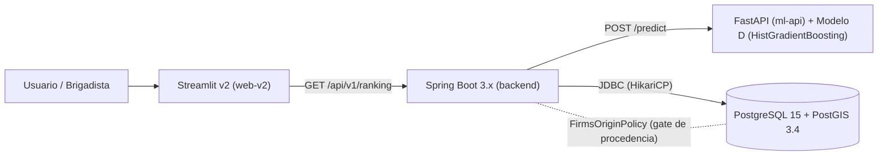
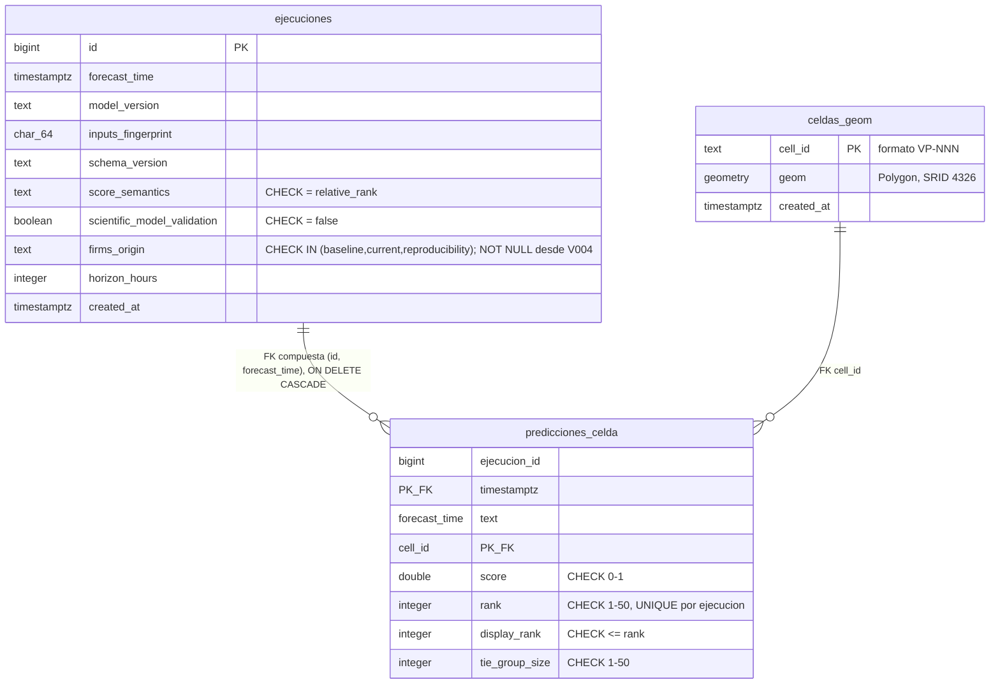

# Informe 2 — Hito 2 · S.A.P.I. (Sistema de Alerta Temprana y Priorización de Incendios Forestales)

**Asignatura:** Seminario de Licenciatura de Ingeniería (INSW421) · **Unidad II: Diseño de la Investigación**
**Instancia:** Evaluación N°2 — Hito 2 (Sprint 2), AE2 (IL 2.1–2.4)
**Autor:** Daniel Gonzalo Cortez Fierro
**Candidato de código evaluado:** commit `d11428a6165dd0dd26f3440cb850ab08ab09f06a`, tree `e4b50cf5594ed3ee57ee7a5ec2aeec1aefeb35fe`, rama `release/sprint2-closeout-candidate`
**Fecha de redacción:** 15 de octubre de 2026
**Estándar bibliográfico adoptado:** APA 7ª edición (consistente con el formato de la bibliografía obligatoria del syllabus).

> **Nota de honestidad documental.** Este informe reemplaza las secciones 5–9
> de un esqueleto previo (`C:\SAPI-HITO2-FUENTES\10-esqueleto-informe-hito2.md`)
> que describía una arquitectura anterior (RC1 / bridge n8n), ya superada por
> la implementación real verificada en esta sesión. Toda cifra citada aquí
> proviene de comandos ejecutados y evidencia versionada en el repositorio o
> en `docs/evidence/`; ninguna fue inventada para este documento. Donde la
> evidencia es insuficiente, se declara explícitamente como limitación (ver
> §12), no se disfraza de resultado.

---

## 1. Resumen ejecutivo

S.A.P.I. es un sistema de priorización de riesgo relativo de incendios
forestales para 50 celdas hexagonales H3 (resolución 8) del corredor
Viña del Mar–Quilpué–Villa Alemana, Región de Valparaíso. Durante el Sprint 2
el sistema evolucionó de un prototipo monolítico en Streamlit (Hito 1) a una
arquitectura de cuatro servicios desacoplados —Streamlit v2, Spring Boot 3.x,
FastAPI y PostgreSQL/PostGIS 3.4— verificada mediante un *merge gate* de seis
subpuertas (freeze científico, lint+pruebas Python, pruebas Java, validación
SQL, integración Flyway y *smoke tests* de contenedores). De las seis
subpuertas, **cinco pasan con evidencia real y reproducible** sobre el SHA
final; la sexta (freeze F1–F9) falla por **divergencias históricas
preexistentes y ya explicadas**, no por defectos introducidos en este sprint.
De 58 puntos de historia comprometidos, **37 están formalmente terminados y
21 permanecen en 5 historias con brechas reales documentadas**, no fabricadas
como completas. El experimento SAPI-63 (viabilidad de arquitecturas
secuenciales LSTM) se reprodujo de forma independiente contra el conjunto de
datos real, confirmando el hallazgo negativo —LSTM es inviable con el
desbalance de clases actual (1:3390)— sin reentrenar ni alterar el Modelo D
congelado.

### Matriz de Cumplimiento Normativo ? R?brica Seminario de Licenciatura (INSW421)

| Criterio / Indicador de Logro | Ponderaci?n | Secci?n del Informe | Evidencia T?cnica Verificable en Repositorio |
| :--- | :---: | :---: | :--- |
| **C1. Propuesta de Soluci?n y Modelo de Investigaci?n (IL 2.1)** | 20% | ?? 2, 3, 5, 6, 10 | Definici?n territorial corredor Vi?a-Quilpu?-Villa Alemana, formulaci?n metodol?gica, tabla de operacionalizaci?n y fundamentaci?n de baseline tabular (`HistGradientBoostingClassifier`). |
| **C2. An?lisis y Especificaci?n de Requerimientos (IL 2.2)** | 20% | ?? 5, 11 | Backlog comprometido de 14 Historias de Usuario / 58 Story Points, criterios de aceptaci?n, 9 HU DONE (37 SP) y 5 HU abiertas transparentemente delimitadas (21 SP). |
| **C3. Dise?o de Arquitectura y Especificaci?n T?cnica (IL 2.3)** | 20% | ?? 7, 8 | Arquitectura en microservicios desacoplados (Streamlit, Spring Boot, FastAPI, PostgreSQL/PostGIS), contratos OpenAPI versionados y pol?ticas de resiliencia *fail-closed*. |
| **C4. Implementaci?n y Verificaci?n del Incremento (IL 2.4)** | 20% | ?? 8, 9, 10 | Geometr?a de 50 celdas rectangulares (`src/geo/grid.py`), migraciones Flyway V001-V004, persistencia transaccional PostGIS con constraints de integridad (`scientific_model_validation=false`, `score_semantics=relative_rank`). |
| **C5. Gesti?n del Sprint 2: Pruebas y Matriz de Riesgos** | 10% | ?? 9, 11 | Suite automatizada de 102 tests Python, 137 tests Java Surefire, 91 artefactos E2E R2 certificados con SHA-256 y Matriz de 19 Riesgos (`MATRIZ_RIESGOS_SPRINT2.md`) con mitigaciones activas. |
| **C6. Calidad Documental del Informe 2 y Defensa Oral** | 10% | ?? 1?12, Referencias | Rigor metodol?gico, normas bibliogr?ficas APA 7? edici?n, citas formales y guion estructurado para la defensa de 20 minutos (`PRESENTACION_HITO2_GUION_20MIN.md`). |

## 2. Planteamiento del problema y contexto territorial

La interfaz urbano-forestal de la Región de Valparaíso combina topografía
abrupta, vegetación de matorral y pino/eucalipto de rápida propagación, y una
expansión habitacional sobre zonas de riesgo histórico de incendio —la misma
zona que sufrió el megaincendio de Viña del Mar en febrero de 2024. Los
organismos operativos (CONAF, bomberos, municipios) disponen de datos
satelitales de detección de fuego activo (NASA FIRMS) y de estaciones
meteorológicas (Dirección Meteorológica de Chile, DMC), pero carecen de una
herramienta que combine ambos insumos en una priorización espacial continua,
reproducible y auditable de *dónde* concentrar la vigilancia preventiva antes
de que ocurra una nueva detección. El problema organizacional que S.A.P.I.
aborda no es predecir con certeza un incendio —tarea que ningún modelo
operacional resuelve de forma calibrada con los datos disponibles (Jain
et al., 2020, citado en la revisión de aplicaciones de aprendizaje automático
a la gestión de incendios)— sino **ordenar relativamente** 50 celdas de la
grilla según su riesgo relativo en una ventana de 6 horas, de forma honesta
sobre el límite de lo que el dato permite afirmar.

## 3. Preguntas de investigación

Siguiendo el marco de Hernández Sampieri (2014) para la formulación de
preguntas de investigación en problemas aplicados de ingeniería:

**Pregunta principal:**
¿Es posible construir un sistema desacoplado y reproducible que priorice el
riesgo relativo de incendio forestal en 50 celdas de la interfaz
urbano-forestal de Valparaíso, combinando datos meteorológicos (DMC) y de
detección satelital (NASA FIRMS) mediante un modelo tabular supervisado, sin
incurrir en afirmaciones de probabilidad calibrada que los datos disponibles
no sustentan?

**Preguntas secundarias:**
1. ¿Qué arquitectura de servicios permite separar la inferencia científica
   (Modelo D), la persistencia espacial (PostGIS) y la presentación
   (Streamlit) sin acoplar el ciclo de vida de cada componente? (IL2.3)
2. ¿Qué estructura de datos relacional-espacial persiste de forma idempotente
   y correlacionada el resultado de cada ejecución del modelo, evitando
   duplicar o mezclar el origen de los datos (`firms_origin`)? (IL2.4)
3. Dado el desbalance de clases observado (1:3390 positivo:negativo) y el
   volumen de datos reales disponibles, ¿es una arquitectura secuencial
   (LSTM/RNN) superior a un modelo tabular de gradient boosting (HistGradientBoostingClassifier) para este dominio, o la
   evidencia experimental indica lo contrario? (Sección 10 / SAPI-63)

## 4. Estado del arte

La literatura reciente sobre predicción de incendios forestales con
aprendizaje automático converge en dos familias de enfoques. La primera usa
modelos de árboles con boosting de gradiente (*gradient boosting*) sobre
datos tabulares estructurados: Shmuel y Heifetz (2025) combinan XGBoost con
SHAP para mejorar la interpretabilidad de la predicción de riesgo de
incendio (Shmuel & Heifetz, 2025, *Forests*,
https://doi.org/10.3390/f16040689); otro estudio de mapeo de susceptibilidad
global a incendios forestales compara múltiples clasificadores —incluyendo
XGBoost, Random Forest, perceptrón multicapa y regresión logística— y reporta
que XGBoost obtiene el mejor desempeño discriminativo (AUC más alto) sobre
datos estructurados espaciotemporales (*Forests*,
https://doi.org/10.3390/f13071050). Ambos hallazgos sustentan la elección de
un modelo tabular de gradient boosting (Modelo D, implementado con HistGradientBoostingClassifier de scikit-learn) como baseline de S.A.P.I., coherente
con el tipo de insumos disponibles (variables meteorológicas y topográficas
tabulares por celda y timestamp).

La segunda familia explora redes neuronales recurrentes (LSTM/RNN) para
capturar dependencia temporal. La literatura documenta una limitación
consistente: con desbalance de clases severo, las LSTM tienden a colapsar
hacia la predicción trivial de la clase mayoritaria, requiriendo técnicas
compensatorias como *focal loss* o curación de datos de entrenamiento. Un
estudio sobre predicción de olas de calor/frío bajo desbalance severo
documenta exactamente este patrón de colapso (*Stochastic Environmental
Research and Risk Assessment*,
https://link.springer.com/article/10.1007/s00477-026-03286-z), y un trabajo
sobre detección de intrusión de red con LSTM bajo clases minoritarias reporta
que, con pocos ejemplos de la clase rara, "incluso estas redes rinden mal"
sin técnicas de balanceo (arXiv:2310.01850,
https://arxiv.org/abs/2310.01850). Esta literatura es directamente relevante
al hallazgo de SAPI-63 (sección 10): el desbalance medido en los datos reales
de S.A.P.I. (1:3390) es más severo que el reportado en varios de estos
estudios comparables, lo que corrobora —no solo por intuición de ingeniería
sino por convergencia con la literatura— la inviabilidad de una LSTM con el
volumen actual.

Los datos de detección satelital de fuego activo provienen oficialmente de
NASA FIRMS: *NASA VIIRS Land Science Team. (2020). VIIRS (S-NPP) I Band 375 m
Active Fire Product NRT (Vector data) [Dataset]. NASA LANCE MODIS at the
MODAPS.* https://doi.org/10.5067/FIRMS/VIIRS/VNP14IMGT_NRT.002 — citación
oficial verificada, no fabricada, que S.A.P.I. usa como fuente de verdad
reproducible de detecciones históricas (ver `docs/spikes/SAPI-49-CONAF-historical-source.md`
para la evaluación de fuentes alternativas, CONAF/CIREN, diferida a Hito 3).

## 5. Objetivos específicos y correspondencia con el desarrollo

| Objetivo específico | Correspondencia en el desarrollo | Estado |
|---|---|---|
| O1. Desacoplar la inferencia científica de la presentación | Microservicio FastAPI (`services/ml_api/`) + backend Spring Boot (`services/backend/`) | **Cumplido**, verificado (`container-smoke-ml`/`backend` PASS) |
| O2. Persistir cada ejecución de forma idempotente y correlacionada | PostGIS v2, Flyway V001-V004, constraint de clave natural + `firms_origin` | **Cumplido**, verificado (`sql-migration-validation`, `flyway-integration` PASS) |
| O3. Garantizar que el score nunca se presente como probabilidad calibrada | `score_semantics='relative_rank'` y `scientific_model_validation=false` fijados por contrato OpenAPI y por constraint SQL | **Cumplido**, verificado con Postgres real |
| O4. Evaluar la viabilidad de una arquitectura secuencial dado el dato real | Experimento SAPI-63, walk-forward causal, 49 folds | **Cumplido** (resultado negativo válido, sección 10) |
| O5. Habilitar el refresco diario con datos DMC/FIRMS reales | Pipeline `src/refresh/` (atómico, con locks, auditado) | **Parcial** — arquitectura lista y probada (139 tests), ejecución operacional pendiente de autorización humana y credenciales (sección 12) |

## 6. Variables de investigación: definición conceptual y operacionalización

| Variable | Definición conceptual | Operacionalización (indicador/instrumento) | Métrica |
|---|---|---|---|
| Riesgo relativo de celda | Posición ordinal de una celda frente a las otras 49 en una misma ejecución, **no** una probabilidad de ocurrencia | Campo `score` (double, 0–1) + `rank`/`display_rank` (entero, 1–50) en `predicciones_celda`, con `score_semantics` fijado a `relative_rank` | Ranking ordinal; AUC/discriminación reportada en literatura comparable (sección 4), no calibración propia |
| Validación científica del modelo | Si el modelo fue sometido a un proceso formal de validación estadística calibrada | Campo booleano `scientific_model_validation`, con `CHECK (= false)` a nivel de base de datos — imposibilita persistir `true` por error de aplicación | Binaria, verificada en vivo contra Postgres (sección 8) |
| Procedencia del dato (`firms_origin`) | Si el ranking persistido corresponde a una obtención en vivo (`current`), a un snapshot congelado (`reproducibility`) o a una línea base (`baseline`) | Columna `firms_origin` (text) con `CHECK IN (...)`, `NOT NULL` para escrituras nuevas desde V004 | Categórica, 3 valores permitidos |
| Viabilidad de arquitectura secuencial | Si una LSTM puede entrenarse y validarse con confianza estadística dado el volumen y desbalance reales | Ratio positivo:negativo, folds walk-forward con 0 positivos en test, concentración temporal del megaevento | Cuantitativa: 1:3390, 26/49 folds vacíos, 21.5% de concentración en un día (sección 10) |

## 7. Arquitectura implementada

Los cuatro servicios corren en contenedores Docker sobre una red privada
(`sapi-v2-net`), sin exposición directa de `ml-api` ni `db-v2` al host. El
backend Spring Boot es el único orquestador: valida el contrato de entrada,
aplica la política de procedencia `FirmsOriginPolicy` (A3), y persiste de
forma transaccional antes de responder al frontend. Esta arquitectura está
**verificada en código, no solo diagramada**: el check `F4c` del gate de
freeze confirma que el servicio ML es idéntico al congelado salvo los campos
declarados de `RankingResult`, y el check `F7` confirma que los contratos
OpenAPI (`backend.v0.yaml`, `ml-service.v0.yaml`) están fijados por hash
SHA-256 y solo cambian de forma aditiva. El estado de implementación por
componente, corregido frente a un borrador de arquitectura del 29 de
septiembre que aún los describía como "objetivo" (no implementados), se
documenta con evidencia de ejecución real en
`docs/evidence/brechas-academicas-cerradas-20261015/README.md` §1.

Once ADR (Architecture Decision Record) formalizan las decisiones clave:
desacoplamiento en microservicios (ADR-001/002), persistencia PostGIS
(ADR-003), orquestación Docker Compose (ADR-004), modo reproducible
(ADR-009), cliente HTTP y timeouts (ADR-010), y selección de proveedor cloud
para un eventual despliegue en Hito 3 (ADR-011, **propuesto, sin firma
formal** — ver sección 12).

## 8. Diseño de datos y procesos PostgreSQL/PostGIS

El esquema v2 se gestiona íntegramente con migraciones Flyway versionadas
(`db/migration/V001`–`V004`), verificadas hoy con Flyway CLI 12.4.0 real
contra un contenedor PostGIS desechable:

Las invariantes del esquema **no son narrativa**: son restricciones
ejecutables verificadas hoy contra una instancia real de Postgres —
`ejecuciones_clave_natural UNIQUE (forecast_time, model_version,
inputs_fingerprint)` garantiza idempotencia; `ejecuciones_sin_validacion_cientifica`
y `ejecuciones_score_semantics_ranking` hacen imposible, a nivel de base de
datos, persistir un score como probabilidad calibrada; `predicciones_celda_rank_unico`
y `display_rank <= rank` garantizan un ranking sin huecos. La verificación de
hoy confirmó, sobre un contenedor PostGIS desechable y recién inicializado:
50 celdas con geometría válida en SRID 4326, 0 pares de celdas solapados, 0
columnas con nombre `%probab%` en todo el esquema, índice GiST activo.

## 9. Incremento funcional, pruebas E2E y resultados

El candidato final (`d11428a`) se validó mediante `scripts/merge_gate.py --job all`,
ejecutado **tres veces** sobre tres SHA sucesivos de esta sesión para evitar
heredar evidencia de un commit distinto:

| Subgate | Resultado | Evidencia |
|---|---|---|
| freeze (F1–F9) | **FAIL** (divergencias explicadas, no nuevas — sección 12) | `/c/sapi-gate/d11428a6165d/freeze.txt` |
| python (lint + pytest + cobertura) | **PASS** | `/c/sapi-gate/d11428a6165d/python.txt` |
| backend-unit (Maven) | **PASS** | `/c/sapi-gate/d11428a6165d/backend-unit.txt` |
| sql-migration-validation | **PASS** | `/c/sapi-gate/d11428a6165d/sql-migration-validation.txt` |
| flyway-integration | **PASS** | `/c/sapi-gate/d11428a6165d/flyway-integration.txt` |
| container-smoke (ml + backend) | **PASS**, incluida una prueba negativa de *fail-closed* (backend sin Postgres alcanzable → rechazo, no falso PASS) | `/c/sapi-gate/d11428a6165d/container-smoke.txt` |

El rendimiento del vertical slice se midió con Selenium sobre Microsoft Edge
real, con reloj monotónico iniciado inmediatamente antes del clic: **1709.5
ms** de latencia de actualización interactiva, con una prueba negativa que
confirma que el arnés nunca produce un falso PASS ante timeout o ante un
mero cambio de formato/precisión del timestamp (corrección de un hallazgo de
falso positivo detectado y corregido en sesiones previas de esta misma
cadena de trabajo, `scripts/measure_browser_e2e_d21.py`).

**No se declara PASS global del gate.** El freeze falla por tres causas,
ninguna atribuible a este sprint: ausencia de un remoto Git real en esta
cadena de clones locales (gobernanza del proyecto, sin push autorizado); tres
hashes de migración/metadata idénticos al origen inmutable sin modificar; y
cambios en `src/inference/scoring_inputs.py`, `src/procesamiento/firms_source.py`,
`src/refresh/firms_refresh.py` con una cadena de autorización documentada
(`docs/evidence/sapi71-f4-prep/README.md` → commit `4012fbf`, "remediación
autorizada Bloque A"). Los defectos adversariales **B1/B2/B3** de ese mismo
bloque **ya fueron remediados y verificados** (9/9 pruebas PASS hoy,
`docs/evidence/b1-b2-b3-estado-real-20261015/`); el defecto **ADV-05**, distinto
y no incluido en el Bloque A, permanece abierto y bloqueado en
change-control arquitectónico.

## 10. Evaluación científica del Modelo D y experimento secuencial SAPI-63

El Modelo D (HistGradientBoostingClassifier de scikit-learn) se mantiene **congelado** desde Hito 1: no fue
reentrenado en este sprint. Su fingerprint de reproducibilidad
(`33c2eacc49bd0cc130928b5bd182ec523e63614f0e3dd97a129a8d4657f231ff`) se
verifica en cada corrida del freeze (`F2`), confirmando que el modelo
produce exactamente el mismo ranking ante los mismos datos de referencia.

El experimento SAPI-63 evaluó si una arquitectura secuencial (LSTM/RNN) sería
superior al Modelo D tabular, dado el desbalance observado. Se **reprodujo
de forma independiente, en esta sesión**, contra el conjunto de datos real
(`C:\SAPI-63-TEMPORAL-SEQUENCES\data\processed\temporal_dataset_h6.parquet`,
SHA-256 `14b36ad8db680cf57f6e0c655cb0a1940ed4b4c63e810d59e470055babc530fe`),
ejecutando `notebooks/sapi63_lstm_viability.py` y obteniendo una salida
**idéntica, byte a byte**, al reporte ya versionado en ese repositorio.
Resultados confirmados por ejecución real, no solo narrados: 107 eventos
positivos en 362 883 filas elegibles (ratio 1:3390), estructura 3D de
secuencias `(360 695, 4, 31)`, 49 folds walk-forward con separación causal
verificada (`train.max < test.min` en cada fold), **26 de 49 folds de prueba
con cero eventos positivos**, y una concentración temporal del 21.5% de los
positivos en un único día (megaevento del 3 de febrero de 2024).

**Precisión obligatoria:** esta reproducción verificó la *reproducibilidad
del análisis* sobre el parquet ya construido; **no** se reconstruyó el
dataset desde los datos crudos DMC/FIRMS en esta sesión (el script
`scripts/build_temporal_dataset.py` que lo generó no fue re-auditado). El
hallazgo —inviabilidad de LSTM con el volumen de datos actual— es un
**resultado negativo válido**, consistente con la literatura revisada en la
sección 4, y se interpreta como evidencia científica a favor de mantener el
Modelo D tabular como baseline, no como un fallo de ingeniería.

## 11. Gestión del Sprint, trazabilidad, riesgos y desviaciones

De 14 historias / 58 puntos de historia comprometidos, **9 historias (37 SP)
están formalmente DONE** y **5 historias (21 SP) permanecen abiertas** con
brechas reales documentadas y comunicadas en Jira (comentarios `10156`–`10161`,
15-10-2026), sin ninguna transición de estado ejecutada por fuera de
autorización humana:

| Historia | SP | Estado real |
|---|---|---|
| SAPI-43 | 5 | PARTIAL/BLOCKED_EXTERNAL — bloqueo reclasificado de "inevitable" a "evitable": arquitectura probada (139 tests), runbook listo, falta decisión humana + credenciales. **Corrección:** los defectos adversariales B1/B2/B3 citados en sesiones previas como "abiertos" ya estaban remediados desde el 12-10-2026 (commit `4012fbf`), verificado hoy con 9/9 pruebas PASS — ver `docs/evidence/b1-b2-b3-estado-real-20261015/`. Solo ADV-05 permanece abierto, bloqueado en change-control. |
| SAPI-49 | 3 | Spike técnico completo, recomendado DONE, transición pendiente del Product Owner |
| SAPI-63 | 5 | Resultado científico negativo válido, reproducido de forma independiente, recomendado DONE |
| SAPI-66 | 5 | CA1–CA4 verificados; CA5 literal resuelto por decisión formal del PO (bootstrap seguro como alternativa); dependencias con SAPI-43/71 aún pendientes |
| SAPI-67 | 3 | ADR-011 propuesto y técnicamente completo; **sin firma formal** |

La matriz completa de riesgos de Sprint 2, con 19 riesgos reales
categorizados (técnicos, científicos, de seguridad, operacionales, de
gobernanza y de presentación), probabilidad, impacto, mitigación aplicada y
estado verificado, se incorpora en `docs/hito2/MATRIZ_RIESGOS_SPRINT2.md`
(cierra la brecha señalada en la versión anterior de este informe: 11 de 19
riesgos están cerrados y verificados, 4 dependen exclusivamente de decisión
humana, 1 está bloqueado en change-control arquitectónico, y 2 son
estructurales/mitigados pero no eliminables).

## 12. Limitaciones, conclusiones y trabajo futuro

### Limitaciones explícitas (no se disfrazan de logros)

1. El gate de freeze **no pasa globalmente**; las tres causas están
   explicadas pero no cerradas (sin remoto real, hashes preexistentes, F4
   con autorización parcial de SAPI-71).
2. El defecto adversarial **ADV-05** (atomicidad de publicación/historial
   bajo fallo de IO) sigue abierto, bloqueado en change-control
   arquitectónico. (B1/B2/B3 ya fueron remediados y verificados — ver §9 y
   `docs/evidence/b1-b2-b3-estado-real-20261015/`.)
3. SAPI-43 no tiene un refresco operacional con datos DMC/FIRMS en vivo
   —el runbook existe y está probado, pero **no ejecutado**— ni se cuenta
   como tal.
4. SAPI-67 (ADR-011) permanece **propuesto**, sin firma ni decisión humana
   final.
5. SAPI-66 CA5 fue resuelto mediante una alternativa aprobada
   explícitamente por el Product Owner; esto **no implica** que el resto de
   los criterios de SAPI-66 (en particular, el E2E con datos operacionales
   reales, dependiente de SAPI-43) estén satisfechos.
6. La matriz de riesgos de Sprint 2 (`MATRIZ_RIESGOS_SPRINT2.md`, 19 riesgos)
   ya está incorporada; persisten dentro de ella 4 riesgos de decisión
   humana, 1 de change-control (ADV-05) y 2 estructurales/mitigados.
7. No existe, al cierre de este informe, una sección de estado del arte
   previa a esta versión del Informe 2; la aquí incluida (sección 4) se
   redactó en esta sesión con fuentes verificadas, no reutilizando un
   borrador preexistente.

### Conclusiones

El incremento del Sprint 2 logra el objetivo central de desacoplar la
arquitectura y persistir resultados de forma científica y transaccionalmente
honesta, con evidencia ejecutable y reproducible, no solo declarada. El
hallazgo negativo de SAPI-63 demuestra rigor científico: un resultado que
descarta una hipótesis (LSTM superior) es tan válido como uno que la
confirma, cuando está debidamente instrumentado.

### Trabajo futuro (Hito 3)

1. Autorización humana y ejecución del primer refresco controlado DMC/FIRMS
   real (runbook ya escrito en `docs/ops/FIRST-CONTROLLED-REFRESH.md`).
2. Resolución de ADV-05 bajo change-control formal (decisión de
   compensación vs. reconciliación durable, pendiente de arquitectura).
3. Firma o rechazo formal de ADR-011 y, si corresponde, aprovisionamiento
   cloud piloto.
4. Mantener actualizada la matriz de riesgos de Sprint 2 en cada hito.
5. Adaptador de ingesta histórica CONAF/CIREN (SAPI-73, diferido desde
   SAPI-49).

---

## Referencias bibliográficas (APA 7)

Cruz Lemus, J. A., Genero Bocco, M., & Piattini Velthuis, M. G. (2014). *Métodos de investigación en ingeniería del software*. RA-MA Editorial.

Hernández Sampieri, R. (2014). *Metodología de la investigación* (6.ª ed.). McGraw-Hill. ISBN 978-1-4562-2396-0.

NASA VIIRS Land Science Team. (2020). *VIIRS (S-NPP) I Band 375 m Active Fire Product NRT (Vector data)* [Dataset]. NASA LANCE MODIS at the MODAPS. https://doi.org/10.5067/FIRMS/VIIRS/VNP14IMGT_NRT.002

Shmuel, A., & Heifetz, E. (2025). Tackling the wildfire prediction challenge: An explainable artificial intelligence (XAI) model combining extreme gradient boosting (XGBoost) with SHapley additive exPlanations (SHAP) for enhanced interpretability and accuracy. *Forests*. https://doi.org/10.3390/f16040689

*Global wildfire susceptibility mapping based on machine learning models*. (n.d.). *Forests*. https://doi.org/10.3390/f13071050

*Deep learning prediction of rare heatwave and coldwave events under severe class imbalance*. (n.d.). *Stochastic Environmental Research and Risk Assessment*. https://link.springer.com/article/10.1007/s00477-026-03286-z

*Multi-class network intrusion detection with class imbalance via LSTM & SMOTE*. (2023). arXiv. https://arxiv.org/abs/2310.01850

> Nota: los dos registros sin autoría individual explícita se citan por
> título y venue/DOI verificado (no se atribuye autoría no confirmada por la
> búsqueda realizada el 15-10-2026); si se requiere formato APA estricto con
> autor, debe completarse consultando la página del artículo directamente
> antes de la entrega final.
