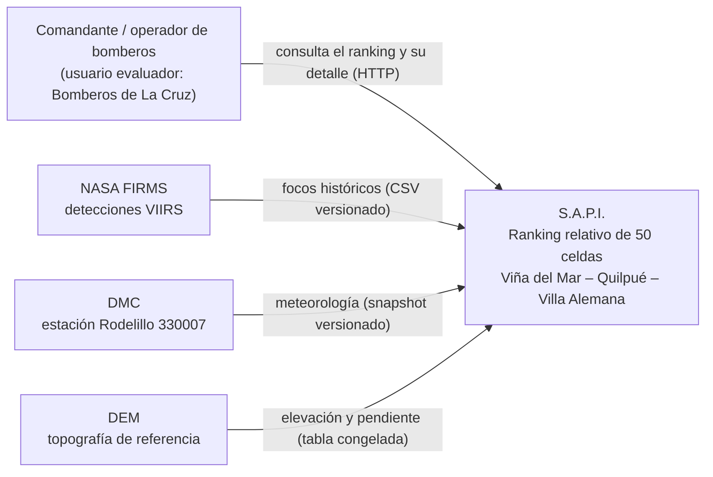
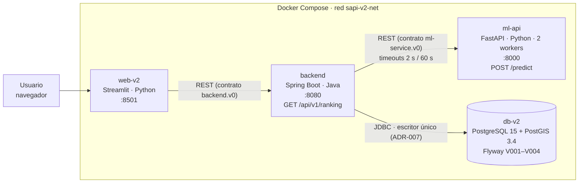
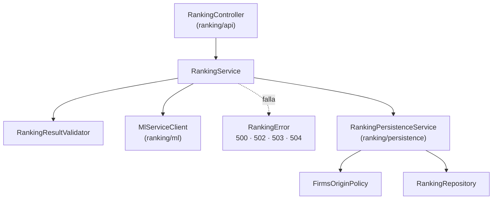
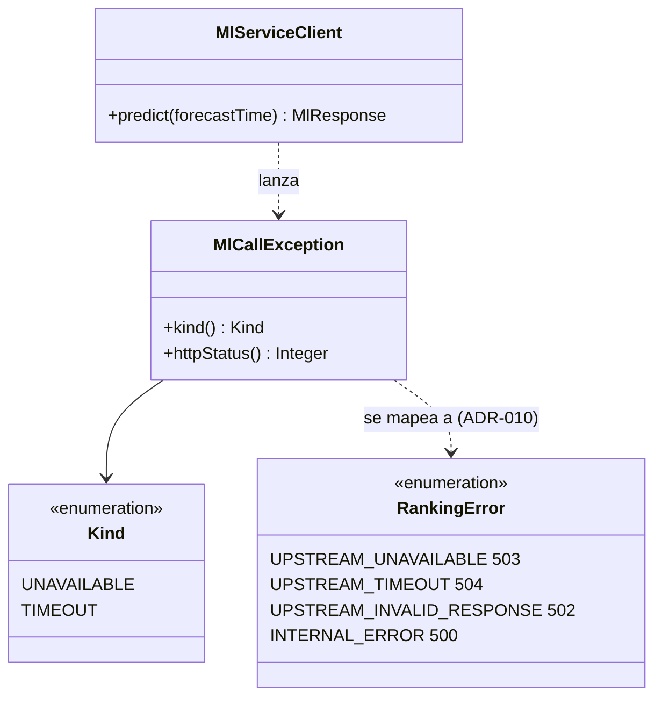
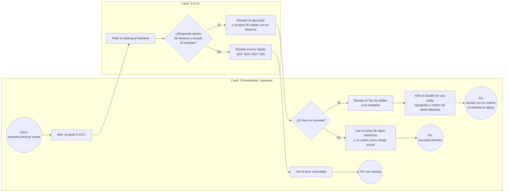

**Camino elegido: B — C4 + BPMN.**

# S.A.P.I.: modelamiento y decisiones arquitectónicas (A7)

Subtareas HU-92.T3 (SAPI-151) y HU-92.T8 (SAPI-175). Versión 0.1, 22-11-2026. Los diagramas representan lo que levanta `docker-compose.yml` en `main` (`9e70867`), no la arquitectura planificada.

## 1. C4 nivel 1: contexto

S.A.P.I. no consulta las fuentes en tiempo real durante la demo: usa snapshots versionados (modo reproducible, ADR-009).

## 2. C4 nivel 2: contenedores

| Contenedor | Responsabilidad | Requisitos | ADR |
|---|---|---|---|
| web-v2 | Muestra el mapa, la tabla y el detalle; no calcula ni rellena nada | RF-01, RF-04, RNF-05 | — |
| backend | API pública, mapeo de errores y persistencia write-through | RF-01, RF-03, RNF-02, RNF-07 | ADR-001, 007, 010 |
| ml-api | Inferencia del Modelo D congelado | RF-02, RF-06 | ADR-002, 006 |
| db-v2 | Ejecuciones y predicciones por celda | RF-03, RNF-01 | ADR-003, 008 |

## 3. C4 nivel 3: componentes del backend

Las pruebas de cada componente están en la matriz de fallas (`docs/pruebas/matriz-fallas.md`, en el PR #51).

## 4. C4 nivel 4: código de un componente (MlServiceClient → RankingError)

Este mapeo explica D-04: un contenedor ML detenido produce `TIMEOUT`, que se responde como 504.

## 5. BPMN: flujo del comandante (proceso que el sistema soporta)

El diagrama está en notación de flujo (Mermaid) y sigue la semántica de BPMN: carriles, evento de inicio, tareas, compuertas y eventos de término. Si la comisión pide BPMN 2.0 estricto, se exporta a bpmn.io.

## 6. Registro de decisiones (ADR)

| ADR | Decisión | Estado | Matriz ponderada |
|---|---|---|---|
| ADR-001 | Spring Boot como backend de aplicación | Propuesto (falta firma) | §7.1 (propuesta) |
| ADR-002 | FastAPI como servicio ML | Propuesto | — |
| ADR-003 | PostgreSQL/PostGIS como persistencia | Propuesto | §7.2 (propuesta) |
| ADR-004 | Docker Compose como entorno reproducible | Propuesto | §7.3 (propuesta, junto con ADR-011) |
| ADR-005 | REST/OpenAPI entre servicios | Propuesto | — |
| ADR-006 | Modelo D como baseline; modelos temporales como experimento | Propuesto | Pendiente: HU-65.T3 (D frente a A frente a temporal) |
| ADR-007 | Backend como escritor único y write-through | Borrador | — |
| ADR-008 | Flyway dentro de Spring Boot; base v2 aislada | Borrador | — |
| ADR-009 | Modo reproducible por defecto | Borrador | — |
| ADR-010 | Cliente HTTP, timeouts y mapeo de errores | Borrador | — |
| ADR-011 | Proveedor cloud | Propuesto; superado por la política de $0 (SAPI-67) | §7.3 |

Ningún ADR tiene aprobación de otra persona. Hay que registrar la firma (HU-92.T3) antes del tag.

## 7. Matrices ponderadas (propuesta, pendiente de aprobación de Daniel)

Puntaje de 1 a 5. Los criterios salen de los requisitos de `docs/requerimientos.md`. **Los pesos los fija Daniel**: estos son una propuesta para discutir. Cada puntaje cita su respaldo.

### 7.1 Backend de aplicación (ADR-001)

| Criterio | Peso | Spring Boot | Extender FastAPI | Node/Express |
|---|---|---|---|---|
| Separar la API pública del cómputo ML (RNF-04) | 35 % | 5: proceso y lenguaje separados | 2: mezcla responsabilidades (texto del ADR) | 5 |
| Mapeo de errores y timeouts tipados (RNF-02, RNF-07) | 25 % | 5: implementado y probado (ADR-010, `MlServiceClientTests`) | 4 | 3: sin precedente en el proyecto |
| Persistencia transaccional con migraciones (RF-03) | 20 % | 5: Flyway integrado (ADR-008) | 3 | 3 |
| Esfuerzo y curva de aprendizaje | 20 % | 3: suma un segundo lenguaje | 5: ya existía | 2: sin experiencia en el equipo |
| **Puntaje ponderado** | 100 % | **4,6** | **3,3** | **3,5** |

### 7.2 Persistencia (ADR-003)

| Criterio | Peso | PostgreSQL/PostGIS | Parquet/CSV | MongoDB |
|---|---|---|---|---|
| Replay sin duplicados por restricción (RNF-01) | 35 % | 5: claves únicas y replay probado (IT-05) | 2: sin restricciones | 3 |
| Consultas espaciales de celdas (RF-01) | 25 % | 5: PostGIS | 2 | 3 |
| Escritura desde varios servicios (RF-03) | 20 % | 5 | 1: sin concurrencia (texto del ADR) | 4 |
| Esfuerzo | 20 % | 4: SQL conocido, esquema legado | 5: ya existía | 3 |
| **Puntaje ponderado** | 100 % | **4,8** | **2,4** | **3,2** |

### 7.3 Entorno de despliegue (ADR-004 y ADR-011)

| Criterio | Peso | Docker Compose local | Kubernetes local | PaaS cloud (Railway/Render) |
|---|---|---|---|---|
| Costo adicional (restricción de $0 CLP, SAPI-67) | 35 % | 5: $0 | 5: $0 | 2: requiere plan o tarjeta (ADR-011) |
| Un comando desde un clon limpio (RNF-08) | 30 % | 5: `docker compose up --build` | 2: sobreingeniería (texto del ADR) | 3: hay que desacoplar el compose (ADR-011) |
| «Ambiente desplegado» para la defensa (criterio 7 de Matías) | 20 % | 2: local; pendiente de que Matías confirme (I-03) | 2 | 5 |
| Esfuerzo | 15 % | 5: ya funciona | 2 | 3 |
| **Puntaje ponderado** | 100 % | **4,4** | **3,1** | **3,1** |

Lectura: Compose local gana mientras rija la restricción de $0. Si Matías no acepta el entorno local (R-12), el criterio de «ambiente desplegado» decide y hay que revisar la matriz con un PaaS gratuito sin tarjeta.

## 8. Stack justificado

El stack sale de estas decisiones, no de una lista de herramientas:
- **Java/Spring Boot** porque separa la API pública del cómputo (7.1).
- **Python/FastAPI** porque el Modelo D y su pipeline ya están en Python (ADR-002).
- **PostgreSQL/PostGIS** por las restricciones únicas y la geometría (7.2).
- **Streamlit** porque se conserva la interfaz existente (freeze del Sprint 2).
- **Docker Compose** por costo y reproducibilidad (7.3).
