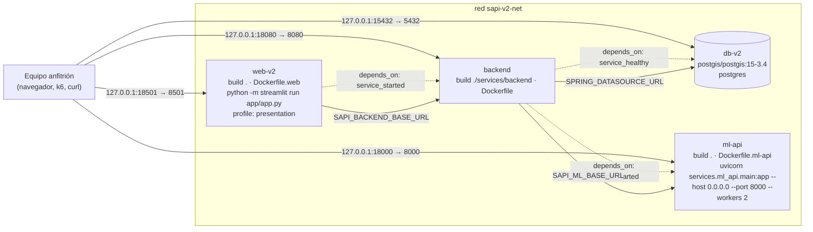
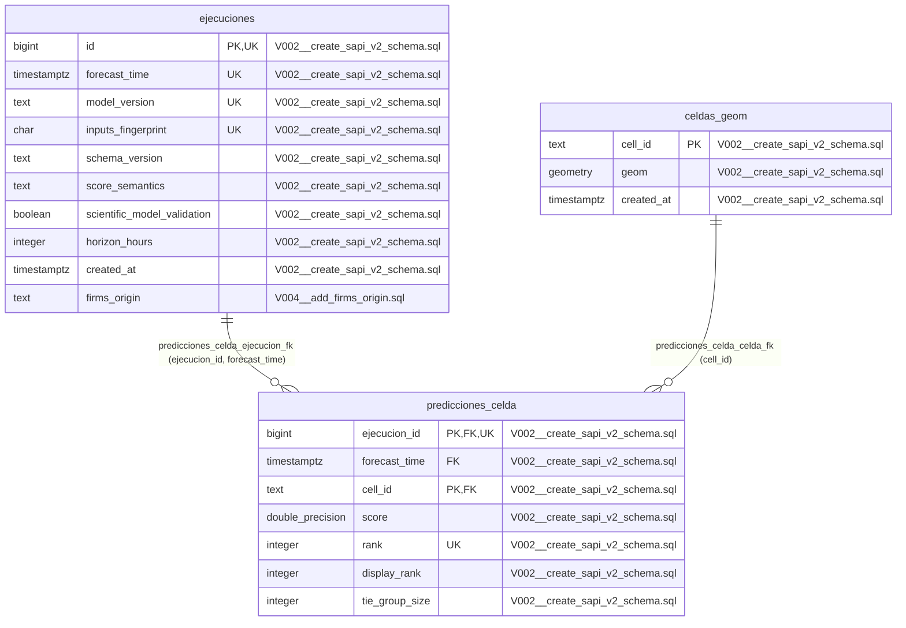

# C4 de contenedores y ERD generados (no editar a mano)

Generado por [evidencia/generar_c4_erd.py](evidencia/generar_c4_erd.py) desde [evidencia/compose-config-518c0b5.json](evidencia/compose-config-518c0b5.json) y `db/migration/` (V001__enable_postgis.sql, V002__create_sapi_v2_schema.sql, V003__seed_celdas_geom.sql, V004__add_firms_origin.sql). Para regenerarlo: `py -I docs/arquitectura/evidencia/generar_c4_erd.py > docs/arquitectura/c4-contenedores-y-erd-generados.md`.

## C4 nivel 2 · contenedores según `docker compose config` (profile `presentation`)

Las flechas de llamada salen de las variables de entorno que apuntan a otro servicio por nombre; las punteadas, de `depends_on`; las del anfitrión, de `ports`.

| Servicio | Imagen o build | Puertos en el anfitrión | Volúmenes | Red | depends_on |
|---|---|---|---|---|---|
| backend | `./services/backend` (Dockerfile) | 127.0.0.1:18080→8080 | ./db/migration→/app/db/migration (ro), sapi_v2_secrets→/run/sapi-secrets (ro) | sapi-v2-net | db-v2 (service_healthy), ml-api (service_started) |
| db-v2 | postgis/postgis:15-3.4 | 127.0.0.1:15432→5432 | sapi_v2_pgdata→/var/lib/postgresql/data, sapi_v2_secrets→/run/sapi-secrets | sapi-v2-net | — |
| ml-api | `.` (Dockerfile.ml-api) | 127.0.0.1:18000→8000 | — | sapi-v2-net | — |
| web-v2 | `.` (Dockerfile.web) | 127.0.0.1:18501→8501 | — | sapi-v2-net | backend (service_started) |

## ERD · desde `db/migration`

Cada columna lleva la migración que la crea. PK, FK y UK según las restricciones declaradas.

### Cotejo con la base del stack `sapi-h3-518c0b5`

Fuente: [evidencia/esquema-vivo-h3.txt](evidencia/esquema-vivo-h3.txt) (information_schema y `flyway_schema_history`).

| Tabla | Columnas según migraciones | Columnas en la base h3 | ¿Iguales y en el mismo orden? |
|---|---|---|---|
| celdas_geom | 3 | 3 | Sí |
| ejecuciones | 10 | 10 | Sí |
| predicciones_celda | 7 | 7 | Sí |

Claves foráneas: 2 según migraciones, 2 en la base h3. Resultado del cotejo: **coinciden**.
