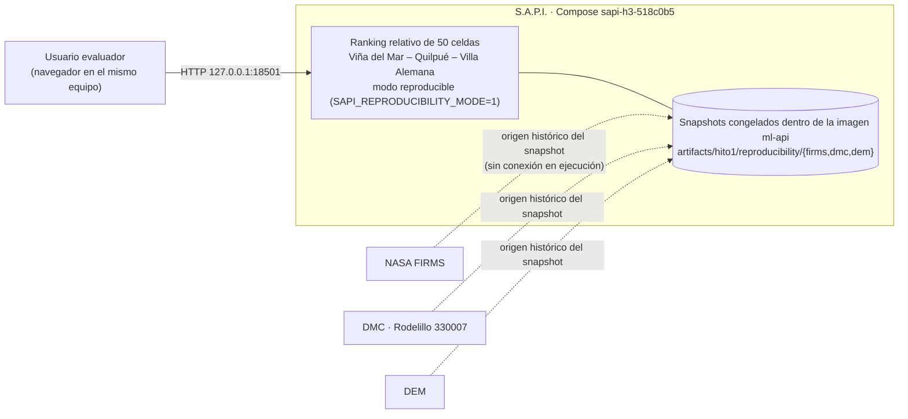

# Criterio 5 · C4 y ERD contra el Compose real · 25-11-2026

- Código: `518c0b58e6b229317f51b1da56ac23346dc2ef74` (el árbol de esta rama no cambia `docker-compose.yml`, `db/migration` ni los Dockerfile respecto de 518c0b5; y `git diff 9e70867 518c0b5` sobre esos archivos está vacío, verificado hoy).
- Stack de referencia: `sapi-h3-518c0b5`, arriba. Solo se leyó: `docker compose config`, `docker ps`, `information_schema` de la base h3 y listados de archivos dentro de los contenedores. No se paró ni se reinició nada.
- Ejecutado en el computador local, no en ambiente desplegado.

## 1. Primera línea de `docs/arquitectura/README.md`

El archivo se trajo **sin cambios** desde `9657bad` (`git checkout 9657bad -- docs/arquitectura/README.md`). Su primera línea es `**Camino elegido: B — C4 + BPMN.**`. El plan la cita como «Camino elegido: C4 + BPMN»; el texto real incluye «B —» y el formato en negrita. **No se modificó**: se respeta tal como está en `9657bad`. El README no se editó en ninguna otra parte; los hallazgos sobre su contenido van en la sección 4.

## 2. C4 nivel 1 · contexto (según el stack real)

Respaldo (verificado hoy, 11:20 UTC): dentro de `sapi-h3-518c0b5-ml-api-1` existe `/app/artifacts/hito1/reproducibility/` con `dem`, `dmc`, `firms` y `manifest.json`, y `SAPI_REPRODUCIBILITY_MODE=1`. Dentro de `sapi-h3-518c0b5-web-v2-1`, `/app/data/raw` solo tiene `.gitkeep` (0 archivos `dmc_meteo_*`): `.dockerignore` excluye `data/raw/*` y el Compose no monta `./data` en `web-v2`. Por eso la barra DMC de la interfaz dice «NO DISPONIBLE» en este stack (ver `docs/calidad/fiabilidad-modo-degradado-2026-11-25.md`, F-1). **No verificado:** que ningún contenedor abra conexiones salientes a FIRMS o DMC durante la ejecución; las líneas punteadas indican el origen de los datos, no una conexión observada.

## 3. C4 nivel 2 · contenedores y ERD

Generados por script, no a mano: [c4-contenedores-y-erd-generados.md](c4-contenedores-y-erd-generados.md), desde [compose-config-518c0b5.json](evidencia/compose-config-518c0b5.json) y `db/migration/V001–V004`. Contenedores del diagrama: **web-v2, backend, ml-api y db-v2 (PostGIS)**, los 4 que entran con `--profile presentation`. Los servicios con profile `legacy` (`db-postgis`, `analytics-backend`, `web-presentation`) y `ops` (`n8n-bridge`) existen en `docker-compose.yml` pero no forman parte de la ruta v2, y no se dibujan.

Cotejos hechos hoy:

| Qué | Contra qué | Resultado |
|---|---|---|
| Puertos del diagrama (`compose config` con los puertos de h3) | `docker ps` del stack h3 ([puertos-vivos-h3.txt](evidencia/puertos-vivos-h3.txt)) | Coinciden los 4: 127.0.0.1:18501, 18080, 18000 y 15432 |
| Columnas y FK del ERD (parseadas de las migraciones) | `information_schema` de la base h3 ([esquema-vivo-h3.txt](evidencia/esquema-vivo-h3.txt)) | Coinciden: 3, 10 y 7 columnas en el mismo orden; 2 FK |
| Migraciones aplicadas | `flyway_schema_history` de la base h3 | 001–004, las 4 con `success = t` |

**No verificado:** que los bloques Mermaid rendericen; no se pasó un renderizador.

## 4. Cotejo del README de `9657bad` con el Compose real (sin editarlo)

| Sección del README | Coincide con el código y el Compose | Diferencia o hallazgo |
|---|---|---|
| Base declarada (`9e70867`) | Sí: `docker-compose.yml`, `db/migration` y los Dockerfile no cambian entre `9e70867` y `518c0b5` | — |
| C4-1 contexto | Fuentes FIRMS, DMC y DEM como snapshots versionados; coherente con el modo reproducible | No dice que la barra DMC de la interfaz lee `data/raw`, que en `web-v2` está vacío |
| C4-2 contenedores | Mismos 4 servicios, red `sapi-v2-net`, ml-api con 2 workers, Flyway V001–V004, timeouts 2 s / 60 s (valores por defecto del Compose) | **Omite que los 4 puertos se publican en el anfitrión** (127.0.0.1), incluidos el del ml-api y el de la base; ver DEF-SEC-07 en `docs/calidad/seguridad-c4-2026-11-25.md`. Omite los volúmenes y el montaje de solo lectura de las migraciones |
| C4-3 componentes del backend | Las 8 clases nombradas existen en `services/backend/src/main/java/cl/sapi/backend/ranking/` | — |
| C4-4 `RankingError` | Los 4 valores dibujados existen | **Incompleto:** el enum tiene 7 valores; faltan `INVALID_REQUEST` (422), `PROTOTYPE_UNAVAILABLE` (503) y `DATA_UNAVAILABLE` (503) |
| C4-4, frase «un contenedor ML detenido produce `TIMEOUT`, que se responde como 504» (D-04) | `MlServiceClient` distingue `TIMEOUT` (504) de `UNAVAILABLE` (503, sin conexión) | **Contradice la expectativa del procedimiento 6b** (`503 upstream_unavailable` con el ml-api caído). Cuál de los dos ocurre en el stack queda **pendiente** de la ejecución del 6b por Daniel; hoy no se observó |
| BPMN | Fuera del alcance del cotejo de hoy | — |

## 5. Clasificación

- **Verificado hoy:** secciones 2 (salvo lo marcado como no verificado), 3 y 4.
- **Histórico:** el README de `9657bad` (22-11, commit `293ee8f`).
- **Pendiente:** render de los Mermaid; si el ml-api caído da 503 o 504 (6b, Daniel); corregir el README en su propia rama si el Director lo decide.
