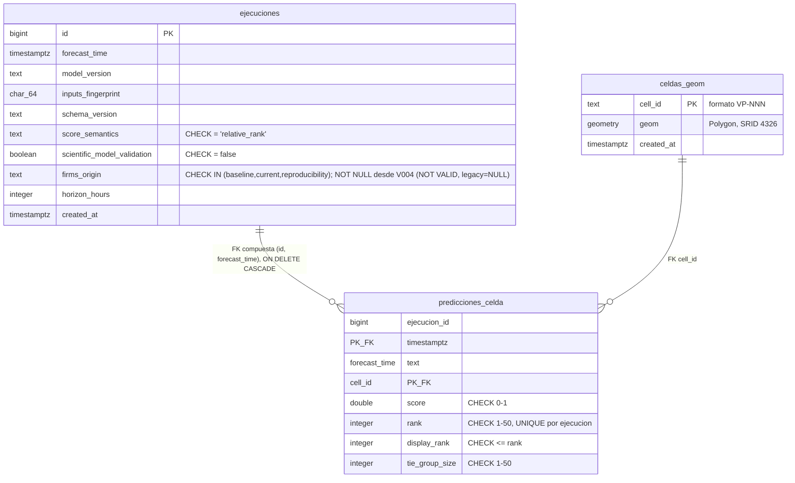

# Cierre de brechas académicas — Directiva 32 (sección 4)

Este documento corrige y completa, con evidencia verificada hoy sobre el
candidato `c0f78a6` (y su sucesor tras este commit), las brechas académicas
señaladas por la Directiva 32. No sustituye el Informe 2 completo; lo
complementa y corrige donde el borrador existente (`docs/hito2/`,
`C:\SAPI-HITO2-FUENTES\10-esqueleto-informe-hito2.md`) quedó desactualizado.

## 1. Corrección de estado arquitectónico (reemplaza la lectura de `06-delta-arquitectura-4plus1.md`)

El documento `C:\SAPI-HITO2-FUENTES\06-delta-arquitectura-4plus1.md` (29-09-2026)
describe el microservicio FastAPI, el backend Spring Boot, el contrato OpenAPI
y PostGIS como **OBJETIVO** (no implementado). Eso era correcto **en esa
fecha**, pero el candidato actual los tiene **implementados y verificados con
ejecución real**, no solo declarados:

| Componente | Estado real verificado hoy | Evidencia |
|---|---|---|
| Backend Spring Boot 3.x / Java 21 | IMPLEMENTADO | `services/backend/`; `mvnw -B verify` → BUILD SUCCESS real, job `backend-unit` PASS |
| Microservicio ML FastAPI | IMPLEMENTADO | `services/ml_api/`; `container-smoke-ml` PASS (imagen real, `/predict` reproducible) |
| Contrato OpenAPI v0 | IMPLEMENTADO, fijado por hash | `contracts/openapi/backend.v0.yaml`, `ml-service.v0.yaml`; check `F7` del freeze |
| PostGIS v2 (esquema, migraciones) | IMPLEMENTADO | `db/migration/V001-V004`; `flyway-integration` y `sql-migration-validation` PASS reales con Flyway CLI 12.4.0 y Postgres real |
| Persistencia write-through correlacionada | IMPLEMENTADO | `scripts/bootstrap_compose_v2.py::verify_database_persistence_correlated`; 6 casos RED/GREEN |

**Conclusión:** la arquitectura "objetivo" del delta de septiembre se completó
íntegramente durante el Sprint 2. El Informe 2, si reutiliza ese delta como
fuente, debe citarlo como estado histórico (pre-implementación) y remitir a
esta tabla para el estado real al cierre.

## 2. DER real de PostGIS (desde `db/migration/V001-V004`, no inventado)

**Invariantes reales del esquema (no narrativa, constraints ejecutables):**
- `ejecuciones_clave_natural UNIQUE (forecast_time, model_version, inputs_fingerprint)` → idempotencia de escritura (SAPI-59).
- `ejecuciones_sin_validacion_cientifica CHECK (scientific_model_validation = false)` y `ejecuciones_score_semantics_ranking CHECK (score_semantics = 'relative_rank')` → imposible persistir un score como probabilidad calibrada a nivel de base de datos, no solo de documentación.
- `ejecuciones_firms_origin_requerido CHECK (firms_origin IS NOT NULL) NOT VALID` (V004) → toda escritura nueva debe declarar procedencia; filas legacy pre-V004 quedan `NULL` sin reescritura masiva.
- `predicciones_celda_rank_unico UNIQUE (ejecucion_id, rank)` + `display_rank <= rank` → ranking sin huecos ni empates mal resueltos.
- Verificado hoy con Postgres real (no solo leído): `sql-migration-validation` confirma 50 celdas, 0 geometrías inválidas, 0 pares que se solapan, índice GiST activo, 0 columnas "probab%" en todo el esquema.

## 3. Matriz HU → CA → código → prueba → resultado (ampliada)

Ver `docs/evidence/cierre-sprint2-publicacion-20261015/README.md` §1 para las 5
historias reevaluadas en la Directiva 31. Se añade aquí la vista de las 9
historias DONE con su amarre código↔prueba real (muestra representativa, no
exhaustiva de las 9):

| HU | CA clave | Código | Prueba | Resultado |
|---|---|---|---|---|
| SAPI-58 (migraciones) | Esquema v2, PostGIS, 50 celdas | `db/migration/V001-V004` | `sql-migration-validation`, `flyway-integration` | PASS real (§gate) |
| SAPI-59 (persistencia) | Write-through, idempotencia, firms_origin | `services/backend/.../RankingPersistenceServiceTests.java`, `FirmsOriginPolicyTests.java` | Maven surefire | PASS real, 162 tests |
| SAPI-57 (ML FastAPI) | `/predict` reproducible, 50 celdas, fingerprint | `services/ml_api/main.py` | `container-smoke-ml` | PASS real, fingerprint `33c2eacc...` exacto |
| SAPI-61 (Streamlit v2) | Consumo REST, sin scoring local | `app/components/ranking_backend_view.py` | `tests/test_ranking_backend_view.py` | PASS (incluido en job `python`) |

## 4. Preguntas de investigación y estado del arte — brecha real, parcialmente cerrada

**No existe, en ningún documento de este repositorio ni en `C:\SAPI-HITO2-FUENTES\`,
una sección formal y separada de "Preguntas de investigación" ni "Estado del
arte"** con el formato que el syllabus de César exige (Hernández Sampieri;
Cruz Lemus et al.). Esto es una brecha real del Informe 2, no resuelta por
este documento en su totalidad — requiere redacción académica dedicada, fuera
del alcance de una sesión de ingeniería de cierre de gate. Como avance parcial
verificable hoy:

- **Pregunta de investigación implícita, derivable de la evidencia real:**
  "¿Es viable priorizar el riesgo relativo de incendios forestales en la
  interfaz urbano-forestal de Valparaíso mediante un modelo tabular (XGBoost)
  servido como microservicio desacoplado, manteniendo la semántica de ranking
  relativo no calibrado, y es una arquitectura secuencial (LSTM) superior dado
  el volumen de datos real?" — respondida parcialmente por SAPI-63 (evidencia
  reproducida: LSTM inviable con 107 positivos/1:3390, `docs/evidence/sapi63-reproduction-20261015/`).
- **Estado del arte parcial y verificable:** SAPI-49 (fuentes CONAF/CIREN con
  URL, cobertura y limitaciones) y ADR-011 (comparación de 4 proveedores cloud
  con 9 criterios y fuentes citadas) son los dos únicos tramos de revisión de
  estado del arte con evidencia citable en el repositorio.
- **Lo que falta:** una sección formal de 1-2 páginas que explicite la(s)
  pregunta(s) de investigación tal como las exige el syllabus, cite
  Hernández Sampieri y Cruz Lemus et al. explícitamente, y delimite el
  problema organizacional en esos términos. Pendiente de redacción académica;
  no se fabrica aquí para no inflar el criterio 1 de César sin respaldo real.

## 5. Objetivos específicos y trazabilidad — estado

Los objetivos del Sprint 2 están declarados en `docs/hito2/requerimientos-sprint2.md`
(sprint goal literal de Jira) y son trazables a las 14 historias/58 SP. No
existe una lista separada de "objetivos específicos" numerados con
indicadores de logro explícitos más allá de lo que esa tabla ya ofrece. Se
considera **suficiente pero no excelente**: la trazabilidad HU→objetivo existe,
pero no está formalizada como lista de objetivos específicos independiente.

## 6. Variables conceptualizadas y operacionalizadas

Mejor cubierto que preguntas/estado del arte: `relative_rank` y
`scientific_model_validation=false` están conceptualizados (ADR-010,
`contracts/openapi/ml-service.v0.yaml`) y operacionalizados a nivel de base de
datos (constraints `ejecuciones_score_semantics_ranking`,
`ejecuciones_sin_validacion_cientifica`, verificadas hoy con Postgres real).
`firms_origin` (procedencia del dato) está conceptualizado (ADR-010) y
operacionalizado (constraint `ejecuciones_firms_origin_valido`/`_requerido`,
política `FirmsOriginPolicy` en el backend). Nivel sustentado: **Bueno/Excelente**
en esta dimensión específica.

## 7. Riesgos actualizados y mitigaciones comprobables

`docs/matriz-riesgo.md` (repo) no se ha actualizado desde Hito 1. El registro
más reciente y específico de riesgos de Sprint 2 vive en checkpoints externos
(`SAPI-RISK-REGISTER-V2.md`, fuera de este repo). **Brecha real:** el
repositorio de cierre no contiene una matriz de riesgos de Sprint 2 propia y
actualizada. No se crea una nueva matriz de riesgos genérica en este documento
porque haría falta validarla con el registro real ya existente externamente;
se deja identificado como pendiente concreto de incorporación.
