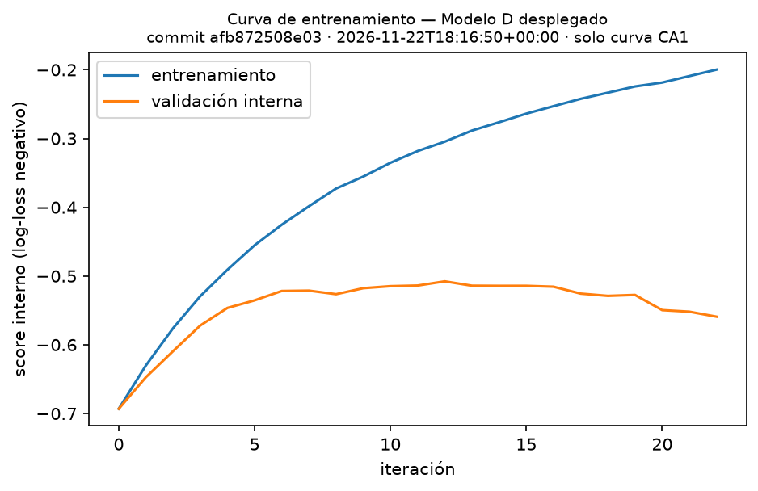
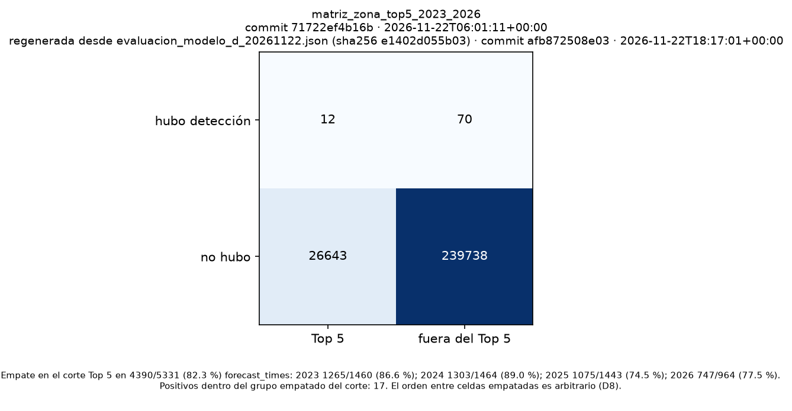
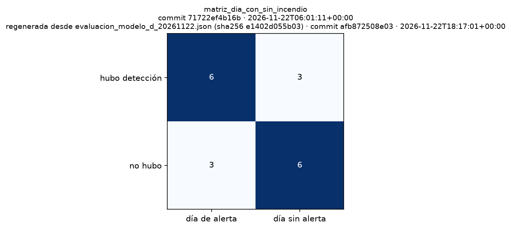

# Informe del Hito 3 — S.A.P.I.

**Sistema de Alerta y Priorización de Riesgo de Incendios**
Seminario de Licenciatura (INSW421, IL 3.4) · Estudiante: Daniel Cortez · Ticket: S3-23 / SAPI-157

| Campo | Valor |
|---|---|
| Versión | 0.1-borrador, 23-11-2026 |
| Estado | **BORRADOR.** No es la entrega oficial. Daniel debe revisarlo, completarlo y aprobarlo |
| Base | `main` = `9e70867bc303e954f03f06964ba505bf839a7957` |
| Rama | `docs/SAPI-157-informe-hito3-o09` (sin push) |
| Redacción | Bot SAPI-Gobernanza, Orden 09, tarea 1 |
| Fuente de la pauta | Revisión del Hito 2 del profesor César (PDF, F-C1). No existe una pauta del Hito 3 de César por escrito (ver L-17) |

Convenciones del documento:

- **Estado** de cada ítem: *Hecho en main* · *En PR sin integrar* · *Pendiente* · *Bloqueado*.
- **Evidencia**: (a) verificada por hash hoy, 23-11-2026 · (b) histórica, fechada y no re-verificada hoy · (c) pendiente, sin ejecución que la respalde. El detalle está en la sección 14.
- Las salvedades están **solo** en la tabla de limitaciones (sección 13). El resto del texto las cita por su ID `L-xx`.
- Las KPI-01..06 están **NO APROBADAS**. HU-64, HU-65 (parte temporal) y HU-93 están **BLOQUEADAS**.

---

## 1. Control de observaciones de César

Tabla de control exigida por SAPI-157 CA7. Cubre los 12 criterios, las 14 observaciones MoSCoW, las recomendaciones para el Hito 3 y la nota sobre la defensa individual. Se cita el PDF (F-C1). El PDF trae 6 recomendaciones; la 3 y la 4 repiten el mismo contenido, por lo que quedan **5 directivas** (DIR-1..DIR-5), que es la cuenta que usa SAPI-157 CA7.

### 1.1 Criterios de la rúbrica (CRIT-01..12)

Puntajes del Hito 2 tomados de F-C1 (máx. / oral / escrito).

| ID | Criterio (pts H2) | Observación de César | Cambio en el Sprint 3 | Sección | Ticket | Estado | Evid. |
|---|---|---|---|---|---|---|---|
| CRIT-01 | Sprint Goal (7/7/7) | «Sprint Goal explícito (sección 6.1).» | Sprint Goal del Sprint 37 cargado en Jira | 2 | SAPI-157 | Hecho en Jira | b |
| CRIT-02 | HU y refinamiento (10/10/5) | HU escritas como tareas técnicas; el rol es «equipo de desarrollo» o «backend» | HU del Sprint 3 con título orientado a usuario y trabajo técnico como subtareas `HU-XX.T#` | 3 | SAPI-64..93 | Pendiente de verificar redacción por HU (L-14) | b |
| CRIT-03 | Criterios de aceptación (8/7/7) | Criterios verificables en el Anexo D | 15/15 HU con CA Dado/Cuando/Entonces | 3 | SAPI-64..93 | Hecho en Jira | b |
| CRIT-04 | Sprint Backlog y Jira (10/10/5) | «Jira no tiene subtareas en ninguna de las 14 historias» | 83 subtareas creadas el 21-11-2026 | 3.2 | SAPI-94..177 | Hecho en Jira; fecha tardía (L-13) | b |
| CRIT-05 | DoD (7/5/5) | Evaluado en la presentación | DoD de 12 condiciones con verificación por HU | 4 | SAPI-176 (HU-92.T9) | En PR sin integrar (#45) | a |
| CRIT-06 | Diseño 4+1 (10/8/10) | Arquitectura, ADR y diagramas con fuente y correspondencia con el código | Modelamiento C4 + BPMN e índice de ADR con matriz ponderada | 5 | SAPI-151, SAPI-175 | En PR sin integrar (#45) | a |
| CRIT-07 | Seguimiento y meetings (8/5/5) | Se mantiene el puntaje | Actas semanales del Sprint 3 | 11.1 | SAPI-159 | **Pendiente.** No hay actas en el repositorio (L-11) | c |
| CRIT-08 | Riesgos e impedimentos (7/5/5) | «Registro con estrategia y contingencia, pero con dos codificaciones» | Registro único R-01..R-24 con equivalencias e historial; impedimentos en tabla propia | 9 | SAPI-174 | En PR sin integrar (#45) | a |
| CRIT-09 | Pruebas y trazabilidad (9/4/8) | «Una prueba falla en main.» | Plan de pruebas sellado; matriz de fallas; gate 6/6 en main; IT-13 sigue abierto | 7 | SAPI-85, SAPI-91, SAPI-172 | Parcial: gate en main; IT-13 pendiente (L-08) | b |
| CRIT-10 | Sprint Review (7/4/4) | Evaluado en la presentación | Review con el profesor: HU aceptadas y rechazadas, acuerdos, SP por fecha | 11.2 | SAPI-161 | **Pendiente.** No realizada | c |
| CRIT-11 | Gestión del cambio (10/10/7,5) | «Falta una decisión trazable por cada hallazgo.» | Esta tabla + registro de decisiones con fecha, motivo y ticket o ADR | 1, 10 | SAPI-160 | Parcial: tabla en borrador; registro pendiente | c |
| CRIT-12 | Retrospectiva (7/4/4) | Evaluado en la presentación | Retrospectiva individual con acciones, dueño y fecha | 11.3 | SAPI-162 | **Pendiente.** No realizada | c |

### 1.2 Observaciones MoSCoW

| # | Prio. | Sección H2 | Observación (F-C1) | Cambio | Sección | Ticket | Estado | Evid. |
|---|---|---|---|---|---|---|---|---|
| M1 | Must | 6.3 y 9.2 HU | HU como enunciados técnicos | HU desde el operador (capitán de bomberos, Bomberos de La Cruz); técnica como subtareas | 3 | SAPI-64..93 | Pendiente de verificar por HU (L-14) | b |
| M2 | Must | 9.2 Tareas | Sin subtareas en las 14 HU | 83 subtareas `HU-XX.T#` y `.V` | 3.2 | SAPI-94..177 | Hecho en Jira (L-13) | b |
| M3 | Must | 12.3 KPI-03 | Meta p95 ≤ 2.000 ms fijada el 29-10 después de medir: «Es un error metodológico.» | KPI-03 declarado como **línea base histórica del Hito 2**; metas del Hito 3 «pendientes de Daniel» antes de medir | 8 | SAPI-173 | En PR sin integrar (#45). Metas sin fijar: **NO APROBADAS** | a |
| M4 | Must | 11.2.4 y 13 Release | Gate 4/6, IT-13 falla, lint falla, sin tag, 11 PR abiertos | Gate 6/6 en `main` (run 41932911572); inventario de PR y ramas | 7.1, 12 | SAPI-85 | Parcial: gate 6/6 en main; IT-13, tag `hito3` e integración pendientes (L-08, L-09) | b |
| M5 | Must | 9.3 Backlog S3 | Backlog del Sprint 3 ausente de Jira al 29-10 | Sprint 37 cargado con 15 HU, CA y subtareas | 3 | Sprint 37 | Hecho en Jira; sprint sin fechas (L-12) | b |
| S1 | Should | Review y retro | No están en el informe | Secciones 11.2 y 11.3 | 11 | SAPI-161, SAPI-162 | **Pendiente** | c |
| S2 | Should | DoD | Definida a mitad de sprint y ausente del informe | Tabla DoD y verificación por HU cerrada | 4 | SAPI-176 | En PR sin integrar (#45); ninguna HU cerrada todavía | a |
| S3 | Should | Todo el documento | Lenguaje de auditoría y salvedades repetidas | Una sola tabla de limitaciones; estilo directo; meta 40–50 páginas | 13 | SAPI-163 | Parcial: tabla única hecha; extensión pendiente (L-16) | c |
| S4 | Should | 8 Riesgos | Dos codificaciones; sin impedimentos ni seguimiento semanal | Registro único R-xx con equivalencias; tabla de impedimentos | 9 | SAPI-174 | En PR sin integrar (#45) | a |
| S5 | Should | 3.5.10 y 16 Modelo D | A supera a D en PR-AUC en 3 de 4 años; D se mantiene porque ya estaba integrado | OE5 redactado como análisis comparativo; ADR del D frente al A | 6.3 | SAPI-173, SAPI-107 | OE5: en PR sin integrar (#45), Daniel confirma. ADR: pendiente | a / c |
| S6 | Should | 12.1 Figuras 15 y 16 | No prueban lo que dicen | Capturas nuevas fechadas con SHA; las figuras de HU-83 entran con hash | 6.2, 7.3 | SAPI-120, SAPI-170 | Pendiente (capturas del panel) | c |
| S7 | Should | 12.1 Interfaz | «no informado por el backend» y 20 de 50 celdas sin DEM (B-13) | Motivo explícito en las tarjetas; decisión B-13 consultada a César | 7.3 | SAPI-86, SAPI-119 | Tarjetas: en PR sin integrar (#48). B-13: **bloqueado** por la respuesta de César | a |
| C1 | Could | Portada y fechas | Informe fechado el 29-10 (v1.9); Hito 2 era el 19-10 | Una sola versión oficial; historial en anexo | Anexo B | SAPI-163 | Pendiente: Daniel fija la versión oficial | c |
| W1 | Won't | 14 Mercado | No aplica a un prototipo académico | Este informe no incluye estudio de mercado | — | SAPI-157 CA6 | Hecho | — |

### 1.3 Directivas para el Hito 3 y nota sobre la defensa

| ID | Directiva (F-C1, «Recomendaciones para el Hito 3») | Cambio | Sección | Ticket | Estado | Evid. |
|---|---|---|---|---|---|---|
| DIR-1 | Rec. 1: defender el Modelo D y la arquitectura; modificar el código en vivo | Explicación del Modelo D en una página y script reproducible; ensayo de cambio en vivo | 6.1 | SAPI-88, SAPI-110..113, SAPI-166 | T1/T2 en PR sin integrar (#46). CA3 (cambio en vivo), CA4 y CA5 pendientes | a / c |
| DIR-2 | Rec. 2: no ampliar el alcance del ML; un SHA, gate en verde, release etiquetado, clon limpio | HU-64, HU-65 (temporal) y HU-93 bloqueadas hasta respuesta escrita de César; gate 6/6 en main | 6.4, 12 | SAPI-165, SAPI-85 | **Bloqueado** (red temporal). Tag y clon limpio pendientes | b / c |
| DIR-3 | Rec. 3 y 4: registrar meetings, acuerdos, Review con el profesor y retrospectiva durante el sprint | Actas, Review y retrospectiva | 11 | SAPI-159, SAPI-161, SAPI-162 | **Pendiente.** Brecha declarada (L-11) | c |
| DIR-4 | Rec. 5: defender con la Tabla 6 aceptando que una variante más simple rinde igual o mejor | Ablación A–D presentada tal cual; OE5 comparativo; R-06 crítico | 6.3 | SAPI-65, SAPI-107 | Ablación: histórica. ADR: pendiente | b / c |
| DIR-5 | Rec. 6: repartir los cierres; en el Sprint 2 se cerraron 18 SP el último día | SP acumulados por fecha de cierre en la Review | 11.2 | SAPI-161 | **Pendiente.** Al 23-11-2026 ninguna HU del Sprint 3 está «Finalizado» | b |
| NOTA | Nota p. 2: en la defensa no se explicó qué aprende el Modelo D, con qué datos ni cómo se construye la variable objetivo. «puede implicar una nota inferior a 4,0» | HU-88 y lectura de figuras de HU-83 (CA6) | 6 | SAPI-88, SAPI-83 | En PR sin integrar (#46, #47) | a |

---

## 2. Sprint Goal y alcance

Sprint Goal del sprint 37 en Jira («Sprint 3 — Consolidación SAPI», board 1), consultado el 23-11-2026:

> «Consolidar la arquitectura, resiliencia operacional y reproducibilidad científica de S.A.P.I., integrando únicamente mejoras verificables y manteniendo protegido el Modelo D oficial»

El sprint figura como `future` y sin fechas (L-12). El alcance excluye: modelos nuevos sin confirmación escrita de César (DIR-2), estudio de mercado (W1) y cualquier uso del score como probabilidad (L-01).

## 3. Historias de usuario y Sprint Backlog

### 3.1 Estado de las HU

Estado en Jira consultado el 23-11-2026 (solo lectura). La columna PR indica la PR abierta que aporta evidencia; ninguna está integrada.

| HU | Jira | Título (Jira) | SP | Estado Jira | PR | Dictamen Auditor (Orden 08) |
|---|---|---|---:|---|---|---|
| HU-64 | SAPI-64 | Red con memoria temporal (RNN frente a GRU/LSTM) | 8 | Por hacer | — | **BLOQUEADA** (SAPI-165) |
| HU-65 | SAPI-65 | Comparar Modelo D, Modelo A y modelo temporal | 5 | Por hacer | — | Parte temporal **BLOQUEADA**; parte D/A pendiente |
| HU-75 | SAPI-75 | Resolver D-05: fallo rápido con la base caída | 5 | Por hacer | — | — |
| HU-76 | SAPI-76 | Automatizar la trazabilidad científica de experimentos | 3 | Por hacer | — | — |
| HU-79 | SAPI-79 | Sesión de validación con Bomberos de La Cruz | 2 | Por hacer | — | — |
| HU-80 | SAPI-80 | Primera pantalla lista para demostración | 2 | Por hacer | #48 | GO para revisión |
| HU-83 | SAPI-83 | Evaluación del Modelo D con datos reales | 3 | En curso | #47 | CI en verde; CA6 pendiente de incorporación |
| HU-85 | SAPI-85 | Gate 6/6, IT-13, lint, integración y tag `hito3` | 8 | Por hacer | #50 | GO como propuesta, tras corregir M-1 |
| HU-86 | SAPI-86 | Tarjetas de clima, B-13 y capturas | 3 | En curso | #48 | GO para revisión |
| HU-88 | SAPI-88 | Explicación del Modelo D en lenguaje simple | 5 | PENDIENTE A VALIDACION | #46 | Orden de integración #45 → #47 → #46 |
| HU-89 | SAPI-89 | Escaneo de seguridad del stack (A6) | 3 | En curso | #49 | GO condicionado (M-1: línea base sin auditar) |
| HU-90 | SAPI-90 | Entorno desplegado reproducible en local | 3 | Por hacer | #52 | GO condicionado (M-1: la prueba no detecta la rotura) |
| HU-91 | SAPI-91 | Validación de la IA: confiabilidad y punto de quiebre | 5 | Por hacer | #51 | GO |
| HU-92 | SAPI-92 | Trazabilidad A1–A9, ADR, riesgos y DoD | 8 | En curso | #45 | Integrar primero |
| HU-93 | SAPI-93 | Predicción del modelo temporal en pantalla | 3 | Por hacer | — | **BLOQUEADA** (SAPI-165) |

Total: 66 SP en 15 HU. **0 HU en «Finalizado».** Ninguna HU tiene aprobación de un stakeholder distinto del estudiante (L-10).

### 3.2 Subtareas

Hay 83 subtareas en Jira (SAPI-94..156, SAPI-158..163 y SAPI-164..177), creadas el 21-11-2026 (fuente: `estado-real-2026-11-22.md`). Cada HU tiene subtareas técnicas `HU-XX.T#` y una subtarea de validación `.V`. **PENDIENTE (Daniel):** insertar la tabla o captura de Jira con las HU y sus subtareas que pide F-C1 («crea las subtareas en Jira y agrega una tabla o captura con ellas para cada HU»).

## 4. Definition of Done

La DoD del Sprint 3 está en `docs/definition-of-done.md` (PR #45, head `58b5ced0692ec1852240a281488778ad8c4b33f7`). Tiene 12 condiciones: CA cumplidos, caso negativo por HU Must, suite y cobertura ≥ 80 %, gate 6/6, fronteras y congelamiento, integridad científica, trazabilidad, mediciones después del sello, revisión independiente, documentación, **aprobación de un stakeholder distinto del estudiante** y cierre en Jira con la tabla marcada. Rige desde su integración y no se aplica de forma retroactiva.

**PENDIENTE:** verificación punto a punto en cada HU cerrada. Hoy no hay ninguna HU cerrada.

## 5. Diseño del incremento

El modelamiento del incremento está en `docs/arquitectura/README.md` (PR #45): C4, BPMN e índice de ADR con matrices ponderadas. ADR-011 (local-first) sigue sin firma y depende de la respuesta de Matías (SAPI-138). Las referencias a Spring Boot, FastAPI y PostGIS describen la arquitectura del pipeline objetivo; el panel Streamlit se conserva.

**PENDIENTE (Daniel):** traer al cuerpo del informe los diagramas de la PR #45 una vez integrada.

## 6. Modelo D

### 6.1 Qué aprende el Modelo D (DIR-1)

La explicación en una página está en `docs/modelo_d_una_pagina.md` y el script reproducible en `scripts/explicar_modelo_d.py` (PR #46, head `a693a27928444c2192a849660755ed93583e3290`). El artefacto desplegado es `models/prototype_model_d.pkl`, SHA-256 `ac017bef1f42a30ac74ba3e3787368c4418798b2d562adcfba01c923cff2173f` (recalculado hoy en `main`).

Pendientes de HU-88 según el Auditor: CA3 (modificación de código en vivo), CA4 (tres preguntas a La Cruz y acta `.V`), CA5 (defensa) y aprobación del stakeholder.

### 6.2 HU-83 CA6 — Lectura de las figuras del Modelo D

**Estado: pendiente del dictamen del Auditor.**

La sección siguiente es la entrega de SAPI-ML y se incorpora **sin modificaciones**:

- Archivo: `reports/sapi83/hu83_ca6_hito3.md`
- Commit: `b759990cfa048e62a52c6b15e2e9dc8f0f17e32f` (rama `ml/sapi-83-preregistro`, sin integrar en `main`)
- SHA-256 del archivo en ese commit: `ba0140fdf2821b5bc68c7d834fbeb7ac20c29858052850f212e43c7c904043ed` (recalculado hoy). El bloque entre los marcadores `INICIO CA6` y `FIN CA6` reproduce ese archivo byte a byte. Comprobación: `awk '/<!-- INICIO CA6/{f=1;next}/<!-- FIN CA6 -->/{f=0}f' docs/informe-hito3/INFORME_HITO3.md | sha256sum` sobre el blob commiteado.
- Los enlaces a imágenes y JSON del bloque son relativos a `reports/sapi83/` del commit `b759990`. Desde esta carpeta no resuelven y esos archivos no están en `main` (L-09). Los SHA-256 de los tres PNG se recalcularon hoy desde ese commit y coinciden con los del bloque (sección 14).

<!-- INICIO CA6 · reports/sapi83/hu83_ca6_hito3.md @ b759990cfa048e62a52c6b15e2e9dc8f0f17e32f · no editar -->
# Hito 3 · HU-83 (SAPI-83), CA6 · Lectura de las figuras del Modelo D

El Modelo D ordena celdas por score de forma exploratoria. La unidad de evaluación por zona es la celda en el instante de pronóstico `T`. El positivo corresponde a una detección válida de NASA FIRMS en `T < t <= T+6h`. FIRMS registra anomalías térmicas satelitales y la etiqueta refleja esa observación. El score expresa un orden relativo. La calibración probabilística y la validación científica para uso operativo siguen pendientes (`scientific_model_validation=false`).

## Procedencia e integridad

Las tres imágenes corresponden a los PNG verificados en la Orden 08 del Auditor para la PR #47, con head `cc711e7adf1e41d7d1ecfe601e0451f43bc39494`. Los tres se incorporaron al repositorio en `8401649c7c5a0a63ef34bd13eaada2c7d25bcc12`, con fecha de autoría `2026-11-22T15:18:17-03:00`.

| Figura | Ruta desde la raíz del repositorio | Fecha UTC del sello de la figura | SHA-256 del PNG |
|---|---|---|---|
| Curva de entrenamiento | `reports/sapi83/curva_ca1_20261122T181645Z/curva_entrenamiento_modelo_d.png` | `2026-11-22T18:16:50Z` | `792f3b6186c4fa3370b9cf4a5237760d787ff8be14191476c955685e82c2d812` |
| Matriz por zona | `reports/sapi83/figuras_regeneradas_20261122T181645Z/figuras_sapi83/matriz_zona_top5_2023_2026.png` | `2026-11-22T18:17:01Z` | `45d9475452e7803a160066c2b521d56cf35f3099aabfb6257de935e30a1000aa` |
| Matriz por día | `reports/sapi83/figuras_regeneradas_20261122T181645Z/figuras_sapi83/matriz_dia_con_sin_incendio.png` | `2026-11-22T18:17:01Z` | `b882581d064d9e68d7db86eefc1911aa00216c81b295a3fbc79ff54e79e1adb4` |

La curva procede de [curva_ca1.json](curva_ca1_20261122T181645Z/curva_ca1.json), que conserva las series internas del artefacto desplegado `models/prototype_model_d.pkl` (SHA-256 `ac017bef1f42a30ac74ba3e3787368c4418798b2d562adcfba01c923cff2173f`). Las matrices citadas se publicaron con la corrección visual E2 a partir de los resultados ya guardados en [evaluacion_modelo_d_20261122.json](../evaluacion_modelo_d_20261122.json), sellados el `2026-11-22T06:01:11Z` con código `71722ef4b16b` y dataset SHA-256 `14b36ad8db680cf57f6e0c655cb0a1940ed4b4c63e810d59e470055babc530fe`. Para cada año de prueba de 2023 a 2026, la evaluación retrospectiva utilizó un ajuste con los años anteriores.

## Curva de entrenamiento del artefacto desplegado

El eje horizontal indica la iteración de boosting y el vertical el log-loss negativo. Un valor más alto equivale a menor pérdida. La serie de entrenamiento pasa de −0,693 a −0,200. La validación interna alcanza su mejor valor en la iteración 12 (−0,508) y termina en −0,559 en la 22. La pérdida de entrenamiento siguió bajando después del mejor punto de validación, un patrón compatible con sobreajuste. La parada temprana se activó después de 10 iteraciones sin superar el mejor valor.

La partición interna del estimador se usa para la parada temprana y carece de separación por años. Su curva describe el ajuste del artefacto desplegado. Las matrices describen las evaluaciones temporales retrospectivas.

## Matriz por zona · detecciones FIRMS dentro del Top 5

Por cada instante de pronóstico se consideran positivas las cinco celdas con mayor score. De 82 casos celda–pronóstico con detección, 12 entraron en el Top 5 (sensibilidad del 14,6 %) y 70 quedaron fuera. Entre los casos sin detección, 26 643 quedaron dentro y 239 738 fuera. La precisión fue del 0,045 % y la especificidad del 90,0 %. La prevalencia baja y la selección de cinco celdas por instante explican por qué una especificidad alta puede coexistir con una precisión y una sensibilidad bajas.

El corte del Top 5 tuvo empates en 4 390 de 5 331 pronósticos (82,3 %), con un rango anual de 74,5 % a 89,0 %. Hubo 17 positivos en los grupos empatados del corte. El orden dentro de esos grupos es arbitrario respecto a la detección y puede afectar qué celdas entran en el Top 5. Los recuentos por año (1/19, 5/46, 4/7 y 2/10 detecciones incluidas, respectivamente) tienen denominadores pequeños y desiguales. La concentración temporal y espacial de casos, en particular en torno al 3 de febrero de 2024, limita la extrapolación a otros periodos y zonas.

## Matriz por día · alertas en 18 días seleccionados

La muestra predefinida incluye nueve días con detección y nueve controles cercanos en fecha, con el 2 y 3 de febrero de 2024 entre los días con detección. Un día UTC se marcó como alerta cuando el máximo diario del score alcanzó o superó el percentil 90 de los máximos diarios de los años de entrenamiento del ajuste correspondiente. El modelo marcó seis de los nueve días con detección y tres de los nueve controles. La sensibilidad y la especificidad fueron del 66,7 % en esta muestra.

Los días se seleccionaron y equilibraron por diseño. Con nueve días en cada clase, un solo día cambia la tasa de esa clase en unos 11 puntos porcentuales. La matriz describe el comportamiento en los casos elegidos. La frecuencia de alertas en operación, el desempeño en otros periodos y la utilidad prospectiva requieren evidencia adicional.

## Verificación y entrega de CA6

El 23 de noviembre de 2026 se cotejaron los tres SHA-256 con la Orden 08 del Auditor y las cifras con los JSON versionados y la nota de empates de CA1. La verificación de esta sección se limitó a la lectura de los resultados y de las imágenes existentes. Los PNG enlazados conservan sus bytes originales.

Pendiente de cierre de CA6. Gobernanza debe integrar esta sección en el informe del Hito 3. Daniel debe comprobar en la versión integrada que aparecen los tres PNG originales y sus rutas, fechas, hashes completos e interpretaciones, y enviar el delta a revisión independiente.
<!-- FIN CA6 -->

### 6.3 Modelo D frente al Modelo A (S5, DIR-4)

Ablación walk-forward del Hito 2 (Informe del Hito 2, §3.5.10; César la cita como «Tabla 6»). Mismo algoritmo, más variables en cada paso: A (2 de historial FIRMS), B (A + 4 meteorológicas), C (B + 16 rezagos), D (C + 3 topográficas).

| Año de prueba | PR-AUC A | PR-AUC B | PR-AUC C | PR-AUC D | ROC-AUC A | ROC-AUC D |
|---|---:|---:|---:|---:|---:|---:|
| 2023 | 0,002989 | 0,0008828 | 0,0007441 | 0,0008561 | 0,4358 | 0,6231 |
| 2024 | 0,03125 | 0,002198 | 0,0248 | 0,01069 | 0,7041 | 0,8512 |
| 2025 | 0,0002502 | 0,0003942 | 0,000691 | 0,0009183 | 0,6168 | 0,6431 |
| 2026 (parcial) | 0,001271 | 0,001005 | 0,00129 | 0,001026 | 0,582 | 0,8136 |

Fuente citada por el Informe del Hito 2: `reports/experiment_abcd_h6_results.json`. Valores no re-ejecutados en el Sprint 3.

Lectura: en PR-AUC el Modelo A supera al D en 2023, 2024 y 2026; el D solo es mejor en 2025. En ROC-AUC, D supera a A en los años mostrados. El D se mantuvo porque era el modelo integrado (ADR-006), no por desempeño. OE5 queda redactado como **análisis comparativo del enfoque**, no como logro predictivo (`docs/objetivos.md`, PR #45; Daniel debe confirmarlo). El ADR del D frente al A (HU-65.T3, SAPI-107) está **pendiente**: necesita la comparación de SAPI-105.

### 6.4 Red temporal (HU-64, HU-65 temporal, HU-93)

**BLOQUEADAS.** La recomendación 2 de César («No ampliar el alcance del modelo de ML») choca con la instrucción oral de entrenar una red temporal. No se entrena ni se muestra nada temporal hasta su confirmación escrita (SAPI-165, «Por hacer»; borrador de consulta no enviado). Riesgo R-08, nivel crítico.

## 7. Pruebas y calidad

### 7.1 Gate y CI

- `main` 9e70867: gate 6/6 en el run 41932911572, según el dictamen del Auditor sobre la PR #50, que remite a una certificación anterior. IT-13 sigue abierto (R-02 / DT-01 en `docs/riesgos.md`).
- Las 8 PR del Sprint 3 (#45–#52) tienen CI en verde sobre su head, según los dictámenes de la Orden 08 (run IDs en la sección 14).
- Lint v2 en local: no evaluado por el Auditor.

### 7.2 Plan de pruebas y matriz de fallas

- Plan del Sprint 3: `docs/pruebas/plan-sprint3.md` (PR #45). Debe integrarse antes que cualquier reporte de HU-83, 89, 90, 91 y 85.T7 (hallazgo M-3).
- Las mediciones de HU-83 R2–R6 (`2175742`, 2026-11-22T06:02:42Z) son anteriores al plan general (`f7c340d`, 2026-11-22T06:08:00Z). Tienen preregistro propio (`c15993c`, sello `71722ef`). Se declara como brecha (L-07).
- Matriz de fallas y puntos de quiebre: `docs/pruebas/matriz-fallas.md` (PR #51). 24 de las 25 pruebas citadas existen en `main`; la que falta está declarada (F-08). Las pruebas Java F-01..F-04 no se rompieron a propósito (sin JDK en el entorno del Auditor).

### 7.3 Resultados por PR

| PR | HU | Resultado técnico (Auditor, Orden 08) | Pendiente |
|---|---|---|---|
| #47 | HU-83 | Fallo previo del job python: ruta FIRMS escrita a mano (defecto de código) y `matplotlib` no declarado (entorno). Corregido en `2e743fe`; head `cc711e7` en verde. Figuras con hash coincidente | CA6 en el informe (sección 6.2), `.V`, aprobación del stakeholder |
| #48 | HU-86, HU-80 | 141 pruebas pasan. Dos roturas a propósito se detectan (2 y 1 fallos) | B-13 (SAPI-119); capturas nuevas con SHA; HU-80 CA3/CA4 |
| #49 | HU-89 | CI de seguridad en verde. 413 hallazgos de la línea base con `is_secret: null` | Auditar la línea base; CA1, CA2 y CA4 parciales |
| #50 | HU-85 | Inventario de PR y ramas como propuesta | Motivo de cierre de #32–#35 («superado funcionalmente; el contenido no está en main»); Docker, tag, acta del Gate B |
| #51 | HU-91 | Matriz verificada contra `main` | Un negativo ejecutado por falla (T2); T3; metas de KPI-06 |
| #52 | HU-90 | 36 pruebas pasan, pero la rotura del health check **no** se detecta (comparación por subcadena) | Corregir la prueba; CA1/CA2 en Docker; CA4 depende de KPI-03; ADR-011 |

## 8. Objetivos y KPI

Fuente: `docs/objetivos.md` (PR #45). **Las seis KPI están NO APROBADAS:** ninguna tiene meta del Hito 3 fijada ni aprobación de un stakeholder.

| KPI | OE | Métrica | Línea base (origen) | Meta H3 | Resultado H3 | Estado |
|---|---|---|---|---|---|---|
| KPI-01 | OE1, OE3 | % de ejecuciones con 50/50 celdas, rank 1–50 y metadatos | Cumplido el 16-10 y el 28-10-2026 (Informe H2, Tabla 53) | Pendiente de Daniel | Por medir | **NO APROBADA** |
| KPI-02 | OE2 | Filas duplicadas al repetir con iguales insumos | 0 (16-10 y 28-10-2026) | Pendiente de Daniel | Por medir | **NO APROBADA** |
| KPI-03 | OE4 | Latencia visible p95 por escenario | **Línea base histórica del Hito 2** (28-10-2026, n = 30): frío 1.330,1 ms; actualizar 1.919,1 ms; recarga 938,9 ms; expandir 615,8 ms. La meta «≤ 2.000 ms» se fijó después de medir y no se usa como cumplida | Pendiente de Daniel; se sella antes de HU-90.T2 | Por medir | **NO APROBADA** |
| KPI-04 | OE4 | Suite sin fallos y cobertura en el SHA de entrega | 28-10-2026: 2138 aprobadas, 1 fallida, cobertura 86,32 %, lint v2 FAIL | Pendiente de Daniel | Por medir | **NO APROBADA** |
| KPI-05 | OE5 | Mejora sobre las bases en particiones ADEQUATE | 1 partición ADEQUATE (2024) | Pendiente de Daniel; puede reformularse con OE5 comparativo | Por medir | **NO APROBADA** |
| KPI-06 | OE3 | % de participantes que interpreta el score como relativo | Sin línea base (no hubo estudio con usuarios) | Pendiente de Daniel, a acordar con el docente | Por medir | **NO APROBADA** |

## 9. Riesgos e impedimentos

El registro único está en `docs/riesgos.md` (PR #45): R-01..R-24, con tabla de equivalencias hacia los códigos del Hito 1, del Sprint 2 (R1..R19) y del Informe del Hito 2 (R-01..R-06, C1). Riesgos de nivel crítico al 22-11-2026:

| ID | Riesgo | Estado |
|---|---|---|
| R-06 | El Modelo D no supera a un baseline simple | Materializado; se declara (sección 6.3) |
| R-08 | Contradicción entre congelar ML y entrenar una red temporal | Abierto (SAPI-165) |
| R-09 | Sprint sobrecomprometido | Materializado |

Impedimentos abiertos (borrador `08_riesgos_bloqueos.md`, códigos provisorios G-Bx):

| ID | Impedimento | Bloquea | Se destraba con |
|---|---|---|---|
| G-B1 | Red temporal sin confirmación escrita de César | HU-64, HU-65 (temporal), HU-93 | Respuesta de César (SAPI-165) |
| G-B2 | Fecha, formato y pauta del informe sin confirmar; sprint sin fechas | Cierre del sprint, Review | Respuesta de César (SAPI-158) |
| G-B3 | ¿Docker Compose local cuenta como «desplegado»? ADR-011 sin firma | HU-90 | Respuesta de Matías (SAPI-138) |
| G-B4 | Decisión B-13: completar el DEM o declarar la limitación | HU-86 CA2 | Respuesta de César (SAPI-119) |
| G-B5 | Metas del Hito 3 sin sellar | HU-90.T2, HU-91.T3, HU-75.T3 | Commit de metas (Daniel) |

**PENDIENTE (Daniel):** historial de severidad por fecha de los riesgos críticos durante el sprint.

## 10. Gestión del cambio

Decisiones con fecha, motivo y ticket que constan en las fuentes:

| Fecha | Decisión | Motivo | Ticket / fuente |
|---|---|---|---|
| 22-11-2026 | Integrar el plan de pruebas (#45) antes que los reportes de HU | Las mediciones deben ser posteriores al plan (M-3) | SAPI-172; dictamen Auditor C |
| 22-11-2026 | KPI-03 pasa a línea base histórica; metas H3 sin fijar hasta decisión de Daniel | MUST M3 de César | SAPI-173 |
| 22-11-2026 | Red temporal bloqueada hasta respuesta escrita de César | DIR-2 | SAPI-165 |
| 23-11-2026 | Orden recomendado de integración: #45 → #47 → #46; #48, #49, #51, #52 después de #45 | Dependencias de proceso y de citas entre PR | Dictámenes Auditor Orden 08 (propuesta; no ejecutada) |

**PENDIENTE (SAPI-160):** registro completo con una decisión por cada hallazgo de César y de Matías.

## 11. Ceremonias del Sprint 3

### 11.1 Reuniones semanales (CRIT-07)

**PENDIENTE.** No hay actas del Sprint 3 en el repositorio (`docs/actas/` no existe en `main`). Las semanas sin registro se declaran como brecha y no se reconstruyen (SAPI-157 CA2).

### 11.2 Sprint Review con el profesor (CRIT-10, DIR-5)

**PENDIENTE.** No realizada. Debe registrar HU aceptadas y rechazadas con la aprobación de La Cruz, acuerdos, acciones correctivas y SP acumulados por fecha de cierre (SAPI-161). La fecha depende de SAPI-158.

### 11.3 Retrospectiva individual (CRIT-12)

**PENDIENTE.** La redacta Daniel: qué funcionó, qué no y acciones de mejora con dueño y fecha (SAPI-162).

## 12. Release y repositorio

- No existe el tag `hito3` (último tag: `v3.2.0-demo-professional`).
- Las 8 PR del Sprint 3 (#45–#52) están abiertas. Ninguna rama del Sprint 3 está integrada en `main`.
- La protección de `main` no se pudo verificar (la API devolvió 403 al Auditor).
- Condición de César para defender el Hito 3: integrar ramas, gate en verde y release etiquetado en un único SHA. **Pendiente** (SAPI-85).

## 13. Tabla única de limitaciones

| ID | Limitación | Efecto | Acción / ticket |
|---|---|---|---|
| L-01 | El score es un orden relativo, no una probabilidad calibrada; `scientific_model_validation=false` | No sirve para decisiones operacionales | Se mantiene; DoD condición 6 |
| L-02 | La etiqueta es una detección NASA FIRMS en `T < t ≤ T+6h`, no un incendio confirmado; no hay fuente CONAF | La verdad terreno es una anomalía térmica satelital | R-03, aceptado |
| L-03 | Meteorología de una sola estación (330007): las 20 variables valen lo mismo en las 50 celdas de un instante | La meteorología no discrimina entre celdas | R-04, aceptado |
| L-04 | 20 de 50 celdas sin DEM (B-13) | Variables topográficas incompletas | SAPI-119, bloqueado |
| L-05 | El Modelo A supera al D en PR-AUC en 3 de 4 años; pocos positivos (107 en 362.883 filas; 23 de 46 de 2024 en un día) | El aporte de meteorología y topografía no está demostrado | R-06; OE5 comparativo; SAPI-107 |
| L-06 | Empates en el corte del Top 5 en el 82,3 % de los pronósticos; denominadores anuales pequeños | El Top 5 depende en parte de un orden arbitrario | Declarado en CA6 |
| L-07 | Las mediciones de HU-83 son 5 minutos anteriores al plan general de pruebas | Brecha de proceso; tienen preregistro propio | Declarada en `docs/objetivos.md` §6 |
| L-08 | IT-13 sigue abierto; lint v2 en local no evaluado | La suite no está limpia en el SHA de entrega | SAPI-85 |
| L-09 | Ninguna PR del Sprint 3 integrada; sin tag `hito3` | Lo citado desde PR no está en `main` y, según la regla de Matías, no cuenta hasta integrarse | SAPI-85; integración por Daniel |
| L-10 | Ninguna HU con aprobación de un stakeholder distinto del estudiante; HU-79 sin agendar | Ninguna HU se puede cerrar según la DoD | SAPI-79, subtareas `.V` |
| L-11 | Sin actas semanales del Sprint 3 | CRIT-07 sin evidencia | SAPI-159; brecha declarada |
| L-12 | Sprint 37 en estado `future` y sin fechas en Jira | No se puede mostrar cadencia ni fecha de inicio | SAPI-158 |
| L-13 | Subtareas creadas el 21-11-2026, no desde el inicio del sprint | MUST M2 cumplido con atraso no determinable | Declarado; no se alteran fechas |
| L-14 | La redacción Como/Quiero/Para de cada HU no se revisó en este borrador | M1 y CRIT-02 sin verificar | Daniel revisa las 15 HU |
| L-15 | La grilla no cubre La Cruz | La opinión de los validadores es hipotética | R-14 |
| L-16 | Este borrador no alcanza las 40–50 páginas | SAPI-157 CA6 incumplido | SAPI-163 |
| L-17 | No hay pauta escrita de César para el Hito 3; se aplican los 12 CRIT del Hito 2. La versión .md de su revisión difiere del PDF | La tabla de control puede no calzar con la pauta final | Consultas SAPI-158 y pauta (no enviadas); se cita el PDF |
| L-18 | Escaneo de seguridad parcial: sin imágenes Docker, Maven ni historial git; línea base sin auditar | A6 incompleto | SAPI-89 |
| L-19 | Entorno local con Docker Compose sin aceptación de Matías como «desplegado» | Criterio 7 de Matías en riesgo | SAPI-138, ADR-011 |
| L-20 | Revisión independiente hecha por bots; el autor de las PR es Daniel con coautoría de IA | Una revisión de IA no sustituye pruebas ni validación científica | R-13; Daniel revisa y responde por las decisiones |

## 14. Evidencia

### (a) Verificada por hash hoy (23-11-2026)

| Objeto | Ruta / referencia | SHA |
|---|---|---|
| Revisión H2 de César (PDF, fuente primaria) | `C:/Desktop/Proyecto SAPI/SPRINT 2/Hito 2 - Daniel Gonzalo Cortez Fierro reivsion profe cesar.pdf` | SHA-256 `b6c8ff85d8260e3fa3f6b78e49391fb2f59dee026fe45d5eec7f8401b45c2f3e` |
| Revisión H2 de César (.md, diferenciado) | `…/Hito 2 - Daniel Gonzalo Cortez Fierro reivsion profe cesar.md` | SHA-256 `9daa768900ff6e800959a46c1997944e48d3085056a252eb7b68d77983b4fb2a` |
| Informe del Hito 2 (.md) | `…/Informe Hito 2 SAPI Daniel Cortez.md` | SHA-256 `83699c8b9218506585a8ff5018ee38db6a44e2b3305133d7c5cac8a5ffa3aed2` |
| Base del informe | `main` | `9e70867bc303e954f03f06964ba505bf839a7957` |
| PR #45 (SAPI-92) | head, `gh pr view 45` | `58b5ced0692ec1852240a281488778ad8c4b33f7` |
| PR #46 (SAPI-88) | head | `a693a27928444c2192a849660755ed93583e3290` |
| PR #47 (SAPI-83) | head | `cc711e7adf1e41d7d1ecfe601e0451f43bc39494` |
| PR #48 (SAPI-86 + SAPI-80) | head | `f8c5218805f94eaa3cbec3572a7825efc6c79bf2` |
| PR #49 (SAPI-89) | head | `cf5f4cc0ef9698786167f18fd28055e83ab0fe7c` |
| PR #50 (SAPI-85) | head | `0c3bc1eb395f5f868e0d6b4ab39aaf51fb28161f` |
| PR #51 (SAPI-91) | head | `960bbe942f2e1cc2f7da5d3a65ae55cb4c08d583` |
| PR #52 (SAPI-90) | head | `a87264b58085d367d1b668ec6767bf515f81f945` |
| Dictamen Auditor: integración #45–#47 | `orden08-C-integracion-45-46-47-20261123.md` | SHA-256 `a437d21414500d0133b722a7f8f6750db481c531ec430c888b0df59501566a05` |
| Dictamen Auditor: reconciliación HU-86 | `orden08-complemento-hu86-reconciliacion-20261123.md` | SHA-256 `f8ad09258a6bc43edcfdf0b8ce56bb5d68ecb54d236d9c263952f0214b44e94e` |
| Dictamen Auditor: PR #47, job python y CA6 | `orden08-pr47-fallo-python-ca6-20261123.md` | SHA-256 `ad01d4481720f2165cdbe63d2a37da73dbc3170758bdcc23e5d9d3450889d812` |
| Dictamen Auditor: PR #48 | `orden08-pr48-sapi86-80-20261123.md` | SHA-256 `acc09a638e00c0ed7d5e664dd1b1f34c05f642a898166d1f04ad720345481d90` |
| Dictamen Auditor: PR #49 | `orden08-pr49-sapi89-20261123.md` | SHA-256 `a9d312dc7d2a5db6132e91f46d129c2a356bc1a4a391a9524b8e41c0db1f395b` |
| Dictamen Auditor: PR #50 | `orden08-pr50-sapi85-20261123.md` | SHA-256 `1915639766942358a369ea36867db696bc23a7ab7898a5e522d1da27e1d52fe1` |
| Dictamen Auditor: PR #51 | `orden08-pr51-sapi91-20261123.md` | SHA-256 `717570a84181e5571df31842f007e5f1dee7d100da8a582f4499a48fe7ffca30` |
| Dictamen Auditor: PR #52 | `orden08-pr52-sapi90-20261123.md` | SHA-256 `9f78b0948b13729edbe251a0dcca3a2e3d51e9792255343e2e51fb016b6a83a1` |
| Entrega CA6 de HU-83 | `reports/sapi83/hu83_ca6_hito3.md` @ `b759990cfa048e62a52c6b15e2e9dc8f0f17e32f` | SHA-256 `ba0140fdf2821b5bc68c7d834fbeb7ac20c29858052850f212e43c7c904043ed` |
| Curva de entrenamiento | `reports/sapi83/curva_ca1_20261122T181645Z/curva_entrenamiento_modelo_d.png` @ `b759990` | SHA-256 `792f3b6186c4fa3370b9cf4a5237760d787ff8be14191476c955685e82c2d812` (coincide con CA6 y con el Auditor) |
| Matriz por zona | `reports/sapi83/figuras_regeneradas_20261122T181645Z/figuras_sapi83/matriz_zona_top5_2023_2026.png` @ `b759990` | SHA-256 `45d9475452e7803a160066c2b521d56cf35f3099aabfb6257de935e30a1000aa` (coincide) |
| Matriz por día | `reports/sapi83/figuras_regeneradas_20261122T181645Z/figuras_sapi83/matriz_dia_con_sin_incendio.png` @ `b759990` | SHA-256 `b882581d064d9e68d7db86eefc1911aa00216c81b295a3fbc79ff54e79e1adb4` (coincide) |
| Series de la curva | `reports/sapi83/curva_ca1_20261122T181645Z/curva_ca1.json` @ `b759990` | SHA-256 `76cbf7e7fadcd48d5332868c89a91a6fcc7e34b27bcfd187d322803f6c3edf6e` |
| Resultados R2–R6 | `reports/evaluacion_modelo_d_20261122.json` @ `b759990` | SHA-256 `e1402d055b03f3805561b23c13136d94ca4578719380e0f5b6ea774c1309dbad` |
| Artefacto Modelo D | `models/prototype_model_d.pkl` @ `main` | SHA-256 `ac017bef1f42a30ac74ba3e3787368c4418798b2d562adcfba01c923cff2173f` (coincide con CA6) |
| Dataset de evaluación | `C:/SAPI-DATOS-VERIFICADOS/20261122/temporal_dataset_h6.parquet` | SHA-256 `14b36ad8db680cf57f6e0c655cb0a1940ed4b4c63e810d59e470055babc530fe` |
| Borradores de gobernanza | `s3-gobernanza/docs/sprint3/gobernanza/*` (copia de trabajo; 5 archivos con cambios sin commit sobre `8e2a6a2`) | Ver Anexo A |

Que un hash coincida prueba que el archivo es el citado, no que su contenido sea correcto.

### (b) Histórica (fechada, no re-verificada hoy)

- Gate 6/6 en `main` 9e70867, run 41932911572 (certificado por el Auditor en un dictamen anterior a la Orden 08).
- CI en verde sobre los heads de #47–#52 (runs: #47 45087015666 / 45087020445; #48 45092804172 / 45092808421; #49 45090351264 / 45090354859 y Seguridad 45090351289 / 45090354809; #50 45090487965 / 45090491290; #51 45092166758 / 45092171142; #52 45094642466 / 45094646680), según los dictámenes de la Orden 08.
- Pruebas locales del Auditor: #48 141 passed; #52 36 passed; HU-83 37 passed sobre `71722ef` (Auditor, `ola1-parte5b`, 22-11-2026).
- Mediciones del Hito 2 (28-10-2026): latencias de KPI-03, suite y cobertura de KPI-04, ablación A–D (Informe del Hito 2).
- Estado de Jira consultado el 23-11-2026 (sin hash): estados de las 15 HU, Sprint Goal del sprint 37, 83 subtareas.

### (c) Pendiente

- Metas del Hito 3 de KPI-01..06 y sus mediciones (todas **NO APROBADAS**).
- Aprobación de stakeholder por HU (`.V`, sesión HU-79).
- Actas semanales, Sprint Review y retrospectiva.
- Integración de #45–#52, tag `hito3` y corrida desde clon limpio.
- IT-13, ADR del D frente al A, decisión B-13, respuesta de César sobre la red temporal (HU-64/65/93 **bloqueadas**), respuesta de Matías sobre el entorno local.
- Dictamen del Auditor sobre la incorporación de CA6 en este informe.
- Tabla o captura de Jira con HU y subtareas; capturas nuevas del panel con SHA.

## 15. Cumplimiento de SAPI-157

| CA | Exigencia | Estado en este borrador |
|---|---|---|
| CA1 | Respuesta escrita de César sobre fecha y formato en el ticket | Pendiente (SAPI-158; borrador no enviado) |
| CA2 | Actas semanales; las semanas sin registro se declaran como brecha | Brecha declarada (11.1, L-11); actas pendientes |
| CA3 | Una decisión con fecha, motivo y ticket o ADR por cada hallazgo | Parcial (sección 10); registro completo pendiente |
| CA4 | Sprint Review con HU aceptadas y rechazadas, aprobación de La Cruz, acuerdos y SP por fecha | Pendiente (11.2) |
| CA5 | Retrospectiva con acciones, dueño y fecha | Pendiente (11.3) |
| CA6 | 40–50 páginas, estilo directo, una tabla de limitaciones, Jira con HU y subtareas, DoD, riesgos unificados, sin mercado, una versión oficial | Parcial: tabla única, DoD, riesgos y sin mercado; extensión, capturas de Jira y versión oficial pendientes |
| CA7 | Abre con la tabla «observación de César → cambio → sección → ticket» con 12 criterios y 5 directivas | Hecho en borrador (sección 1) |

---

## Anexo A. Fuentes de gobernanza (copia de trabajo, 23-11-2026)

Rama `docs/s3-gobernanza`, HEAD `8e2a6a21febbee96e9cf8bb6b4da34b7549ebcbf`. Los archivos marcados con * tienen cambios sin commit: el hash corresponde a la copia de trabajo, no al blob de ese commit.

| Archivo | SHA-256 |
|---|---|
| `00_INDICE.md` * | `3a76cc280ed3c647f5135089289791b5ea23bd8e7b4089e9f370ab6bbac7406d` |
| `01_matriz_cobertura_academica.md` * | `10a2bc75b49e8d64f35e5347b024df63ff99c94a700395aa08962b1f23841253` |
| `01_matriz_cobertura_academica.csv` | `3cc9f49863e44008233407ee8b9cc4dc52b73f7a9ccf5a4790b8da7177b20498` |
| `02_matriz_trazabilidad.md` | `a68987b00bd24d725edb15ce58808b7c4d4a2cd45412bb6c53fb7345aeacc554` |
| `02_matriz_trazabilidad.csv` | `a60fe44872dd7122fa9c4bd13358b4b3977ba3fcc22e2b971e7bcfeb4f0da07b` |
| `03_plan_pruebas_s3.md` * | `0d84e58e717893f3e1ab769e881e0f3d10f53d9e7904a127b9367ff903c0f5ba` |
| `04_objetivos_kpi.md` | `2dccdee46f8021ca71067ff728af0ae71ab606edd1ec619f841c459d11e51572` |
| `06_regularizacion_sprint37.md` | `9b7b782e55ba7897c1a425e4f3d2a3b2a0071814242b4a61120aa13c344dcc69` |
| `07_evidencias_faltantes.md` * | `bda7b216fec96f5e5c6c66ffdbc35dba6b66e6fe8e2670b83322e8d4876bb180` |
| `08_riesgos_bloqueos.md` * | `17062dcb6baabb43a01ac25ed4a9370a1031a2a9f21d805138cd02b09e6e62be` |
| `05_consultas/cesar_SAPI-119_B-13_DEM.md` | `ba1e3370cef9761d2c01f517223b678d2fc9a134f4be4ffb18e79c3f5c46e275` |
| `05_consultas/cesar_SAPI-158_informe_y_review.md` | `43d5f62c542bc19c46a4370529fbb63e0f137a075fa60bf756b2539c71d56c44` |
| `05_consultas/cesar_SAPI-165_red_temporal_directiva2.md` | `abd4c774a3a268e0851519bb645085a8e415b916e7f834d8115367397fd844ed` |
| `05_consultas/cesar_pauta_hito3.md` | `e9dcdab5579a791cd9944469528eb84e6b52275ee6d2d86ba0fd1f705d521fb8` |
| `05_consultas/matias_SAPI-138_despliegue_local.md` | `e2eceeae9e2ca61fbb0e95266c18b0c52510fe6d5f06215ab743d0356374eb04` |
| `../estado-real-2026-11-22.md` (sin rastrear) | `85fadca14cfb6abb740c234928848b07cdd781ee5921a1227033a0f502f0c52a` |

Discrepancias entre el PDF y el .md de César: ver `01_matriz_cobertura_academica.md` §3 (D1–D9). Este informe cita siempre el PDF. La «Guía para asistentes IA» del .md no se usa como criterio.

## Anexo B. Historial de versiones

| Versión | Fecha | Cambio |
|---|---|---|
| 0.1-borrador | 23-11-2026 | Primer borrador: tabla de control, tabla única de limitaciones, CA6 de HU-83 incorporada sin cambios |
