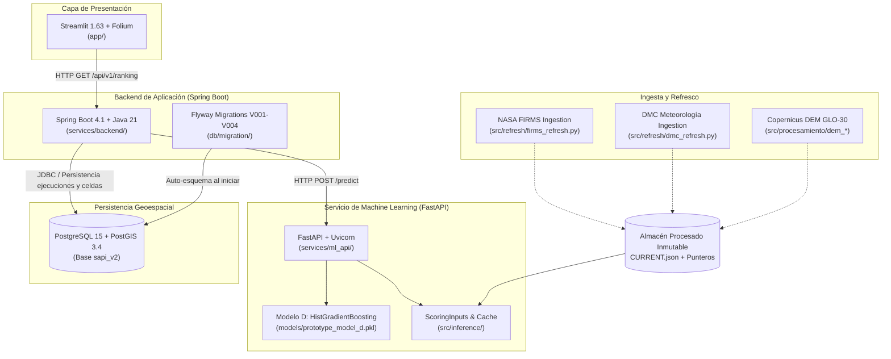

# S.A.P.I. — Mapa Estructural y Arquitectónico del Repositorio
**Documento de Control:** `REPOSITORY_MAP.md`
**Fecha de Publicación:** 2026-10-18
**Autoridad:** Repository Governance Team
**Directiva:** Directiva R1 — Governance & Structural Cleanup

---

## 1. Visión General de la Arquitectura

S.A.P.I. (Sistema de Alerta y Predicción de Incendios) es una plataforma modular de analítica geoespacial y machine learning. Su arquitectura en la versión objetivo (Sprint 2 / Hito 2) desacopla la visualización, la orquestación de negocio, el servicio predictivo y la persistencia relacional espacial:



---

## 2. Mapa Integral de Directorios

Cada directorio está clasificado según las categorías formales de la Directiva R1:
- `[CAT-A]` **Core Protegido:** Código productivo, servicios, modelos y esquemas esenciales.
- `[CAT-B]` **Documentación Activa:** Decisiones, especificaciones, arquitectura y contexto de agentes.
- `[CAT-C]` **Entregables Académicos:** Informes formales UNAB, presentaciones y defensas.
- `[CAT-D]` **Evidencia Histórica:** Manifiestos reproducibles, resultados congelados y auditorías.
- `[CAT-E]` **Archivos Generados:** Temporales, cachés y artefactos dinámicos.
- `[CAT-F]` **Candidatos a Revisión:** Elementos mal ubicados o con dependencias accesorias.

```text
S.A.P.I-Sistema-de-Prediccion-de-Incendios/
│
├── .agents/                      [CAT-B] Catálogo de skills Antigravity e IDEs modernas.
├── .claude/                      [CAT-B] Configuración y skills para Claude Code / Desktop.
├── .github/                      [CAT-A] Configuración de GitHub Actions (ci.yml).
├── .streamlit/                   [CAT-A] Configuración del servidor y temas de Streamlit.
│
├── app/                          [CAT-A] Frontend interactivo Streamlit + Folium.
│   ├── theme/                    Tokens de diseño accesibles (WCAG 2.1 AA) y CSS.
│   ├── views/                    Vistas: Prototipo v2, Centro de Control, métricas.
│   └── components/               Componentes modulares de mapa, tarjetas y filtros.
│
├── artifacts/                    [CAT-D] Repositorio de evidencia histórica y reproducible.
│   ├── hito1/                    Snapshots congelados de Hito 1 (reproducibility/).
│   ├── hito2/                    Quality Gate W0, suites de pruebas y reportes.
│   ├── editorial-smoke/          Evidencia del proceso de maquetación académica.
│   └── toolchain-test/           Verificaciones de compilación y herramientas.
│
├── config/                       [CAT-A] Archivos de configuración de planos de datos.
│   ├── data_plane_rc1.json       Definición de rutas canónicas de datos.
│   └── rc1_convergence_lanes.json Reglas de convergencia de releases.
│
├── contracts/                    [CAT-B] Contratos de interfaz entre subsistemas.
│   └── openapi/                  Especificaciones OpenAPI v0 (backend y ml-service).
│
├── data/                         [CAT-A] Directorio raíz de datos locales (excluidos en Git).
│   ├── predictions/              Predicciones emitidas en tiempo de ejecución (.gitkeep).
│   ├── processed/                Features procesadas y datasets locales (.gitkeep).
│   └── raw/                      Datos satelitales y meteorológicos crudos (.gitkeep).
│
├── db/                           [CAT-A] Persistencia relacional y espacial.
│   ├── migration/                Migraciones Flyway SQL (V001 a V004) para PostGIS v2.
│   └── queries/                  Consultas SQL canónicas (latest_ranking.sql).
│
├── deliverables/                 [CAT-C] Entregables formales de titulación (UNAB).
│   ├── *.docx, *.pdf, *.pptx     Entregables oficiales cerrados de Hito 1.
│   └── hito2-draft/              Borradores en desarrollo para Hito 2 (Word y PDF).
│
├── docker/                       [CAT-A] Tooling e infraestructura Docker.
│   └── initdb/                   Scripts de inicialización SQL para entorno local.
│
├── docs/                         [CAT-B / CAT-C / CAT-D] Documentación integral.
│   ├── adr/                      Architectural Decision Records (ADR-001 a ADR-011).
│   ├── ai/                       Contexto técnico, gobernanza MCP y guías de agentes.
│   ├── defensa-academica/        Guiones de examen, preguntas frecuentes y matrices.
│   ├── evidence/                 Capturas de auditoría en navegador y bitácoras.
│   ├── hito2/                    Informe final Hito 2, rúbricas César/Matías y DoD.
│   ├── ops/                      Manuales operativos, planes de recuperación y fallos.
│   ├── repository-governance/    Auditoría R1, mapa y propuestas de limpieza.
│   └── spikes/                   Investigaciones técnicas exploratorias (CONAF SAPI-49).
│
├── experiments/                  [CAT-A] Módulos de investigación experimental.
│   └── sapi63/                   Viabilidad de secuencias temporales causales.
│
├── models/                       [CAT-A] Artefactos congelados de Machine Learning.
│   ├── prototype_model_d.pkl     Modelo D (HistGradientBoosting) congelado.
│   └── prototype_model_d_metadata.json Metadatos y firma de reproducibilidad.
│
├── notebooks/                    [CAT-D] Notebooks Jupyter de investigación.
│   └── sapi63_lstm_viability.*   Estudio experimental de inviabilidad de redes LSTM.
│
├── ops/                          [CAT-A] Automatización y orquestación externa.
│   └── n8n/                      Flujos sanitizados y políticas seguras para n8n.
│
├── reports/                      [CAT-D] Reportes analíticos generados.
│   ├── megaevento_2024-02-03_report.json Auditoría del evento crítico 2024.
│   ├── auditoria_integridad_datos.json Validación de consistencia temporal.
│   └── sapi63_lstm_viability_report.json Reporte formal de resultados LSTM.
│
├── scripts/                      [CAT-A] Utilidades de build, verificación y preflight.
│   ├── build_prototype_model.py  Pipeline de entrenamiento del Modelo D.
│   ├── freeze_check.py           Comprobación de inmutabilidad de artefactos.
│   └── ai/                       Scripts auxiliares de preflight para agentes.
│
├── services/                     [CAT-A] Código fuente de microservicios.
│   ├── backend/                  Backend Spring Boot en Java 21 (Maven).
│   └── ml_api/                   Microservicio FastAPI en Python 3.14.
│
├── src/                          [CAT-A] Núcleo algorítmico y de procesamiento en Python.
│   ├── geo/                      Definición geométrica de las 50 celdas (Valparaíso).
│   ├── inference/                Servicio de inferencia y fijación de entradas (ScoringInputs).
│   ├── procesamiento/            Ingeniería de variables FIRMS, DMC y DEM.
│   ├── refresh/                  Refrescos atómicos e idempotentes de FIRMS y DMC.
│   ├── output/                   Contratos y manifiestos de salida operacional.
│   └── ops/                      Operador de contingencia y seguridad de workspace.
│
├── tests/                        [CAT-A] Suite de pruebas automatizadas (pytest).
│   └── fixtures/                 Datos sintéticos y mockups controlados para tests.
│
├── tools/                        [CAT-A] Herramientas especializadas de soporte.
│   ├── document_pipeline/        Pipeline de renderizado Word/PDF para Windows.
│   ├── n8n_bridge/               Puente HTTP para integración con n8n.
│   └── ops/                      Herramientas de captura de métricas y scores.
│
└── Archivos en Raíz:
    ├── README.md                 [CAT-B] Documentación general y guía de inicio.
    ├── CONTRIBUTING.md           [CAT-B] Guía de colaboración y estándares de calidad.
    ├── AGENTS.md                 [CAT-B] Directiva permanente de comportamiento de IA.
    ├── CLAUDE.md                 [CAT-B] Guía operativa rápida de comandos y testing.
    ├── docker-compose.yml        [CAT-A] Orquestación multicontenedor de la plataforma.
    ├── requirements*.txt         [CAT-A] Especificación fijada de dependencias Python.
    ├── pytest.ini                [CAT-A] Configuración de pruebas y umbral de cobertura (80%).
    ├── *.png                     [CAT-F] Imágenes en raíz candidatas a reubicación en docs/img/.
    └── SAPI_SPRINT2_CLOSEOUT_REPORT.md [CAT-F] Reporte de cierre candidato a docs/hito2/.
```

---

## 3. Matriz de Componentes Críticos y Puntos de Contacto

| Componente | Ruta Canónica | Rol en el Sistema | Contrato / Protocolo |
|---|---|---|---|
| **Modelo D Baseline** | `models/prototype_model_d.pkl` | Clasificador `HistGradientBoosting` para cálculo de riesgo relativo en 50 celdas. | Inferencia local vía `joblib.load()` |
| **Microservicio ML** | `services/ml_api/main.py` | Encapsula Modelo D y ScoringInputs; expone scoring vía API. | REST / `POST /predict` (OpenAPI v0) |
| **Backend Spring** | `services/backend/` | API Gateway, orquestador, validación de esquemas y auditoría. | REST / `GET /api/v1/ranking` en puerto 8080 |
| **Base de Datos** | `db/migration/` | PostgreSQL 15 + PostGIS 3.4. Tablas `ejecuciones` y `predicciones_celda`. | Conexión JDBC `postgresql://.../sapi_v2` |
| **Dashboard UI** | `app/app.py` | Visualización en Streamlit con mapa territorial Folium interactivo. | HTTP contra Spring Boot en `127.0.0.1:8080` |
| **Ingesta FIRMS** | `src/refresh/firms_refresh.py` | Refresco versionado de anomalías térmicas satelitales NASA VIIRS. | API REST NASA FIRMS (CSV append-only) |
| **Ingesta DMC** | `src/refresh/dmc_refresh.py` | Ingesta meteorológica mensual de estación 330007 (Rodelillo). | API REST DMC Chile (JSON canónico) |
| **Grilla Territorial** | `src/geo/grid.py` | Malla de 50 celdas poligonales de ~15 km² en Viña del Mar – Quilpué. | EPSG:4326 (WGS84) GeoPandas/Shapely |
