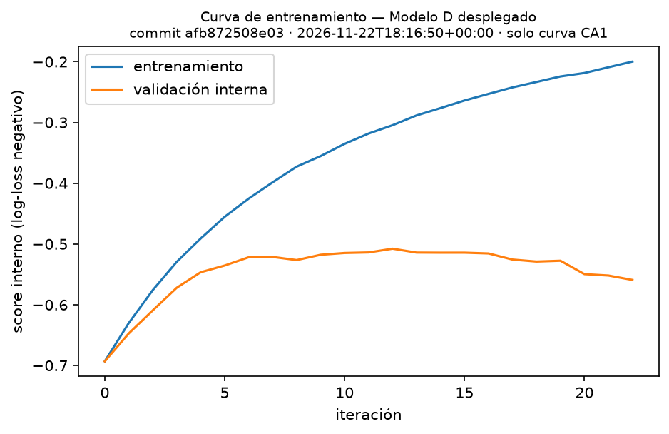
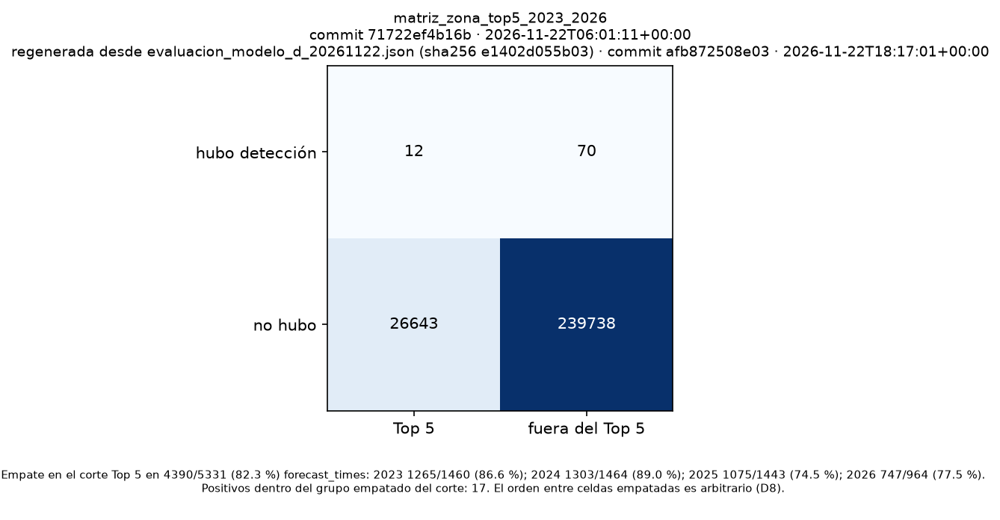
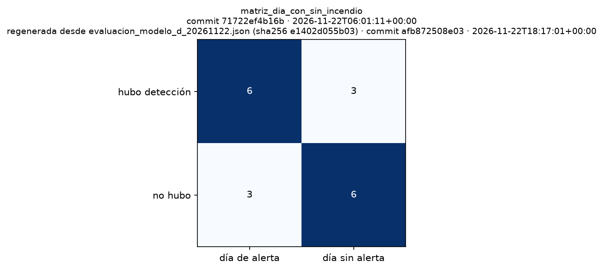

# Hito 3 · HU-83 (SAPI-83), CA6 · Lectura de las figuras del Modelo D

El Modelo D ordena celdas por score de forma exploratoria. La unidad de evaluación por zona es la celda en el instante de pronóstico `T`. El positivo corresponde a una detección válida de NASA FIRMS en `T < t <= T+6h`. FIRMS registra anomalías térmicas satelitales y la etiqueta refleja esa observación. El score expresa un orden relativo. La calibración probabilística y la validación científica para uso operativo siguen pendientes (`scientific_model_validation=false`).

## Procedencia e integridad

Las tres imágenes corresponden a los PNG verificados en la Orden 08 del Auditor para la PR #47, con head `cc711e7adf1e41d7d1ecfe601e0451f43bc39494`. Los tres se incorporaron al repositorio en `8401649c7c5a0a63ef34bd13eaada2c7d25bcc12`, con fecha de autoría `2026-11-22T15:18:17-03:00`.

| Figura | Ruta desde la raíz del repositorio | Fecha UTC del sello de la figura | SHA-256 del PNG |
|---|---|---|---|
| Curva de entrenamiento | `reports/sapi83/curva_ca1_20261122T181645Z/curva_entrenamiento_modelo_d.png` | `2026-11-22T18:16:50Z` | `792f3b6186c4fa3370b9cf4a5237760d787ff8be14191476c955685e82c2d812` |
| Matriz por zona | `reports/sapi83/figuras_regeneradas_20261122T181645Z/figuras_sapi83/matriz_zona_top5_2023_2026.png` | `2026-11-22T18:17:01Z` | `45d9475452e7803a160066c2b521d56cf35f3099aabfb6257de935e30a1000aa` |
| Matriz por día | `reports/sapi83/figuras_regeneradas_20261122T181645Z/figuras_sapi83/matriz_dia_con_sin_incendio.png` | `2026-11-22T18:17:01Z` | `b882581d064d9e68d7db86eefc1911aa00216c81b295a3fbc79ff54e79e1adb4` |

La curva procede de [curva_ca1.json](curva_ca1_20261122T181645Z/curva_ca1.json), que conserva las series internas del artefacto desplegado `models/prototype_model_d.pkl` (SHA-256 `ac017bef1f42a30ac74ba3e3787368c4418798b2d562adcfba01c923cff2173f`). Las matrices citadas se publicaron con la corrección visual E2 a partir de los resultados ya guardados en [evaluacion_modelo_d_20261122.json](../evaluacion_modelo_d_20261122.json), sellados el `2026-11-22T06:01:11Z` con código `71722ef4b16b` y dataset SHA-256 `14b36ad8db680cf57f6e0c655cb0a1940ed4b4c63e810d59e470055babc530fe`. Para cada año de prueba de 2023 a 2026, la evaluación retrospectiva utilizó un ajuste con los años anteriores.

## Curva de entrenamiento del artefacto desplegado

El eje horizontal indica la iteración de boosting y el vertical el log-loss negativo. Un valor más alto equivale a menor pérdida. La serie de entrenamiento pasa de −0,693 a −0,200. La validación interna alcanza su mejor valor en la iteración 12 (−0,508) y termina en −0,559 en la 22. La pérdida de entrenamiento siguió bajando después del mejor punto de validación, un patrón compatible con sobreajuste. La parada temprana se activó después de 10 iteraciones sin superar el mejor valor.

La partición interna del estimador se usa para la parada temprana y carece de separación por años. Su curva describe el ajuste del artefacto desplegado. Las matrices describen las evaluaciones temporales retrospectivas.

## Matriz por zona · detecciones FIRMS dentro del Top 5

Por cada instante de pronóstico se consideran positivas las cinco celdas con mayor score. De 82 casos celda–pronóstico con detección, 12 entraron en el Top 5 (sensibilidad del 14,6 %) y 70 quedaron fuera. Entre los casos sin detección, 26 643 quedaron dentro y 239 738 fuera. La precisión fue del 0,045 % y la especificidad del 90,0 %. La prevalencia baja y la selección de cinco celdas por instante explican por qué una especificidad alta puede coexistir con una precisión y una sensibilidad bajas.

El corte del Top 5 tuvo empates en 4 390 de 5 331 pronósticos (82,3 %), con un rango anual de 74,5 % a 89,0 %. Hubo 17 positivos en los grupos empatados del corte. El orden dentro de esos grupos es arbitrario respecto a la detección y puede afectar qué celdas entran en el Top 5. Los recuentos por año (1/19, 5/46, 4/7 y 2/10 detecciones incluidas, respectivamente) tienen denominadores pequeños y desiguales. La concentración temporal y espacial de casos, en particular en torno al 3 de febrero de 2024, limita la extrapolación a otros periodos y zonas.

## Matriz por día · alertas en 18 días seleccionados

La muestra predefinida incluye nueve días con detección y nueve controles cercanos en fecha, con el 2 y 3 de febrero de 2024 entre los días con detección. Un día UTC se marcó como alerta cuando el máximo diario del score alcanzó o superó el percentil 90 de los máximos diarios de los años de entrenamiento del ajuste correspondiente. El modelo marcó seis de los nueve días con detección y tres de los nueve controles. La sensibilidad y la especificidad fueron del 66,7 % en esta muestra.

Los días se seleccionaron y equilibraron por diseño. Con nueve días en cada clase, un solo día cambia la tasa de esa clase en unos 11 puntos porcentuales. La matriz describe el comportamiento en los casos elegidos. La frecuencia de alertas en operación, el desempeño en otros periodos y la utilidad prospectiva requieren evidencia adicional.

## Verificación y entrega de CA6

El 23 de noviembre de 2026 se cotejaron los tres SHA-256 con la Orden 08 del Auditor y las cifras con los JSON versionados y la nota de empates de CA1. La verificación de esta sección se limitó a la lectura de los resultados y de las imágenes existentes. Los PNG enlazados conservan sus bytes originales.

Pendiente de cierre de CA6. Gobernanza debe integrar esta sección en el informe del Hito 3. Daniel debe comprobar en la versión integrada que aparecen los tres PNG originales y sus rutas, fechas, hashes completos e interpretaciones, y enviar el delta a revisión independiente.
